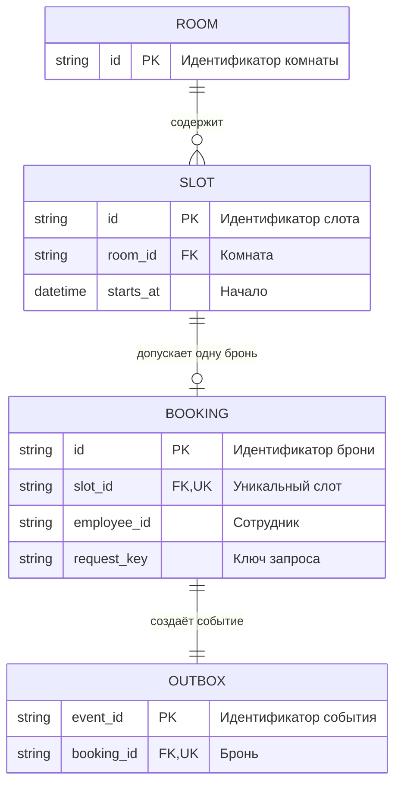

# Данные бронирования

> Учебная целевая модель. Миграции не реализованы; ER-схема показывает смысл, а не заменяет SQL.

## Владение и связи

Владелец модели — модуль бронирования. Идентичность сотрудника подтверждается внешней системой; локальная копия его профиля не нужна.

## Инварианты

Длительность слота — 30 минут, начало выровнено по получасовой сетке; уникальна пара `(room_id, starts_at)`. Так непересечение слотов определяется моделью примера. `BOOKING.slot_id` уникален; пара `(employee_id, request_key)` также уникальна. Одной брони соответствует одно исходящее событие, созданное в той же транзакции.

## Миграция и хранение

До добавления уникальности найти существующие дубликаты и согласовать их разрешение; автоматически удалять чужие брони нельзя. На время изменения схемы исключить создание новых дублей. Способ блокировки или онлайн-миграции зависит от платформы. Тестировать восстановление копии и отказ миграции.

Сроки хранения брони, ключа запроса и события должны быть согласованы вместе: удаление ключа прекращает гарантию распознавания повторов. До этого решения удаление в примере не проектируется. Не хранить токены сеансов в этих сущностях.

## Первоисточник и проверка

В продукте сюда добавляются ссылки на реальные миграции и ограничения. Сейчас их нет, поэтому документ остаётся черновиком. Проверки: конкурентная запись, повтор ключа, внешние связи и атомарность брони с событием.

См. [ADR](../decisions/ADR-0101.md) и [LLD](../lld/booking.md). Референс нотации: [ER-диаграммы Mermaid](https://mermaid.js.org/syntax/entityRelationshipDiagram.html).
