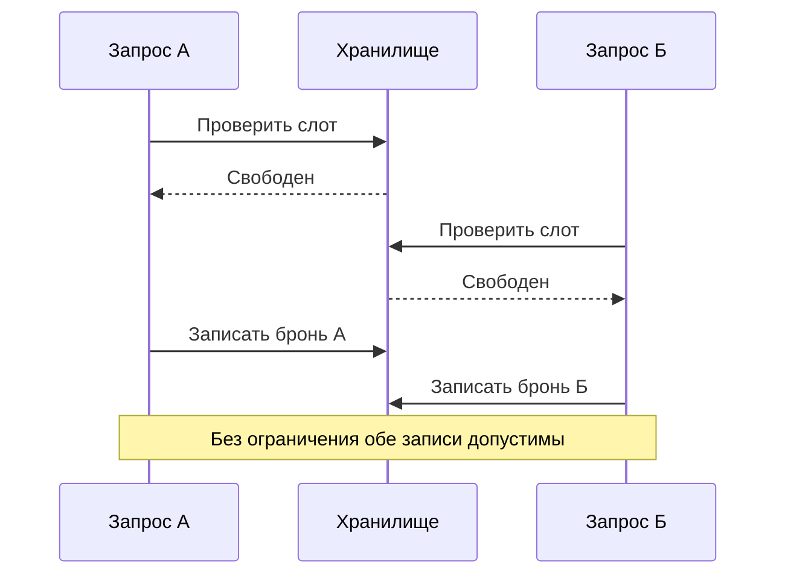

# Гонка при бронировании слота

> Условный пример проблемы в предшествующей реализации учебного продукта. Это не найденный дефект реального репозитория; доказательства ниже — сценарий воспроизведения, который нужно выполнить до регистрации настоящего долга.

## Проблема

Старый алгоритм проверяет занятость перед записью без ограничения уникальности. Два запроса могут сохранить две брони.

## Как подтвердить

Остановить два тестовых запроса после чтения свободного слота, одновременно разрешить запись, посчитать брони. Если их две, приложить тест, журнал, версию кода и путь к обработчику. Без этих доказательств запись остаётся гипотезой, а не подтверждённым долгом.

## Влияние и варианты

Риск — две встречи в одной комнате. При подтверждении проблема требует приоритета до расширения нагрузки. Варианты: ограничение данных из [ADR](../decisions/ADR-0101.md), распределённая блокировка либо временное ограничение нагрузки с явно принятым остаточным риском. Последний вариант не устраняет причину.

## Закрытие

[Инициатива](../initiatives/INIT-0101.md) связывает изменение алгоритма и миграцию данных. Закрыть долг можно после подтверждения отсутствия старых дублей, конкурентной проверки новой записи и обновления LLD. Сейчас состояние — черновик, никаких проверок не выполнено.

Референс содержания: [arc42 — риски и технический долг](https://docs.arc42.org/section-11/).
