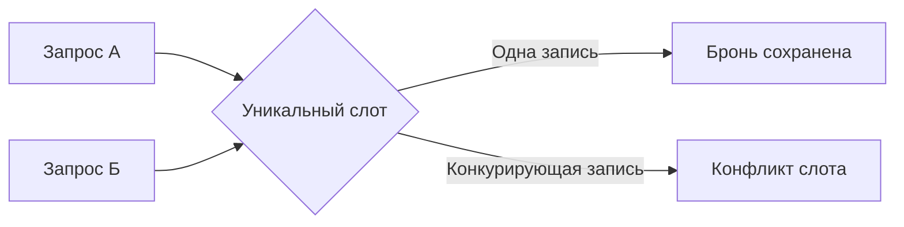

# Исключать двойное бронирование ограничением данных

> Учебное предлагаемое решение; подтверждения принятия нет.

## Контекст

Два экземпляра приложения могут одновременно увидеть свободный слот. Проверка «сначала прочитать, затем записать» не обеспечивает единственность брони. Требуется сохранить инвариант независимо от количества экземпляров приложения.

## Варианты

| Вариант | Преимущество | Ограничение |
| --- | --- | --- |
| Проверка только в приложении | Простой код | Два запроса могут пройти проверку одновременно |
| Распределённая блокировка | Координирует экземпляры | Дополнительные отказы, сроки блокировки и зависимость от сервиса |
| Уникальность слота в БД | Защищает инвариант при записи | Нужно корректно обрабатывать конфликт и проверить семантику СУБД |

## Решение

Предлагается ограничение уникальности `slot_id` в таблице бронирований. Приложение преобразует отказ записи в понятный конфликт. Ключ запроса отличает повтор той же операции от другой брони.

## Последствия

Гарантия действует на уровне данных и при нескольких экземплярах приложения. Слот в этом примере заранее определён; решение не покрывает пересекающиеся произвольные интервалы. Отмена и повторное бронирование потребуют отдельного решения о модели хранения. Конкретная СУБД выбирается платформой.

## Принятие и проверка

Статус остаётся `proposed` до решения владельца продукта. План проверки: 100 конкурентных запросов на один слот оставляют одну бронь; повтор с тем же сотрудником и ключом возвращает её ID. Результатов пока нет.

Связи: [HLD](../hld/README.md), [LLD](../lld/booking.md), [данные](../data/booking.md). Публичный референс формы: [короткий ADR проекта MADR](https://adr.github.io/madr/decisions/0000-use-markdown-architectural-decision-records.html). Сам процесс ADR переиспользуется из upstream.
