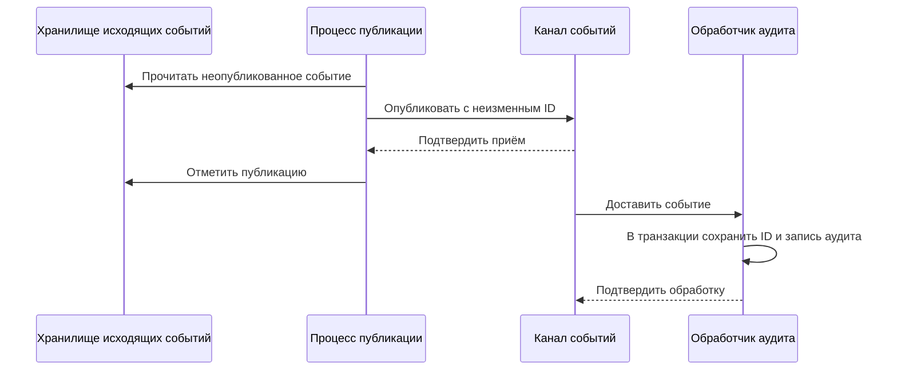

# Событие создания брони

> Учебный контракт поведения. Машинная схема события ещё не создана.

## Назначение

`booking.created.v1` сообщает аудиту о зафиксированной брони. Производитель — модуль бронирования; потребитель — обработчик аудита. Данные: `event_id`, `booking_id`, `occurred_at`, `schema_version`. Токены и имя сотрудника в событие не включаются.

## Доставка и ошибки

Доставка допускает повторы. Если процесс упал после публикации, но до отметки в БД, событие отправляется снова с тем же ID. Потребитель хранит ID события вместе с записью аудита в одной транзакции и пропускает уже обработанное событие. Это не обещание доставки «ровно один раз» транспортом.

Порядок событий не гарантируется; для данного потребителя он не нужен. При временном отказе повторять доставку с ограниченной частотой; после исчерпания лимита сохранять событие для разбора и повторной обработки, не удалять молча. Значения лимитов задаются платформой и требованиями продукта.

## Совместимость и проверка

Новые необязательные поля не должны ломать старого потребителя. Изменение смысла или обязательных полей требует новой версии и переходного периода. Проверить повторную доставку, сбой между публикацией и отметкой, откат транзакции потребителя и восстановление накопившихся событий. Результатов пока нет.

Машинный первоисточник должен описывать сообщения и канал; в настоящем продукте здесь нужна ссылка на него. [AsyncAPI](https://www.asyncapi.com/docs/concepts/asyncapi-document) — один из возможных форматов, не обязательный выбор платформы. Связи: [HLD](../hld/README.md), [данные](../data/booking.md).
