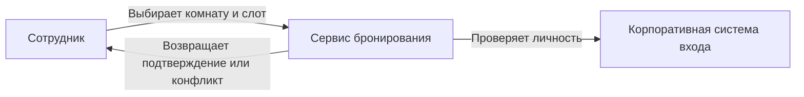
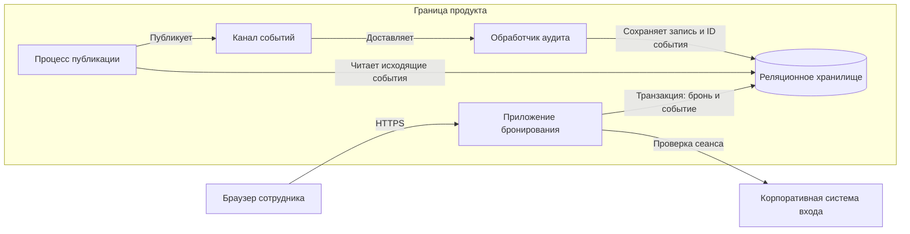
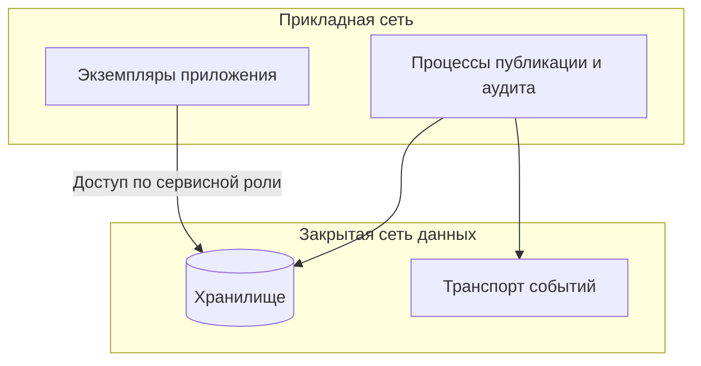

# Бронирование переговорных — HLD

> Учебная целевая архитектура. Реализации и результатов измерений нет.

## Назначение и контекст

Сотрудник бронирует заранее определённый получасовой слот одной переговорной. Один слот может иметь только одно бронирование. Отмена, повторяющиеся встречи и произвольные интервалы не входят в этот пример.

## Компоненты и связи

Сервис входа находится вне границы продукта. Выбор СУБД, среды исполнения и транспорта событий принадлежит платформе; здесь показаны их роли. Приложение не ждёт публикации события для ответа сотруднику. Гарантия отсутствия двойного бронирования определяется [ADR](../decisions/ADR-0101.md).

## Развёртывание

Это логическая схема целевого окружения, а не готовый план отказоустойчивости. Конкретные узлы, резервирование и команды размещения должны быть взяты из платформы до выпуска.

## Требования качества

| Цель примера | Как проверить |
| --- | --- |
| Одна бронь на слот при 100 конкурентных запросах | Интеграционная проверка инварианта в БД |
| p95 ответа ≤ 500 мс при 20 запросах/с | Нагрузочный сценарий на согласованном окружении |
| Повтор запроса после потери ответа возвращает прежнюю бронь | Проверка ключа идемпотентности |
| После восстановления публикации все накопленные события доходят до аудита | Сбой процесса и сверка ID событий |

Пороги иллюстративные; ни один результат не заявлен как достигнутый.

## Эксплуатация и безопасность

Отслеживать частоту ошибок, задержку ответа и возраст старейшего неопубликованного события. Проверять восстановление резервной копии до выпуска; допустимую потерю данных и время восстановления согласовать с владельцем продукта. Откат приложения допускается только при совместимой схеме данных.

Проверять сеанс и право бронировать на сервере. Не принимать ID сотрудника из тела запроса как доказательство личности. Доступ к данным — по сервисным ролям; в журнал не писать токены и персональные сведения.

## Детали и риски

[LLD](../lld/booking.md), [модель данных](../data/booking.md) и [событие](../events/booking-created.md) уточняют устройство. Главный риск — конфликт при параллельном бронировании; его устранение описано в [инициативе](../initiatives/INIT-0101.md). Все разделы HLD находятся в этом файле.

Референсы формы: [контекст C4](https://c4model.com/diagrams/system-context), [контейнеры C4](https://c4model.com/diagrams/container), [развёртывание C4](https://c4model.com/diagrams/deployment).
