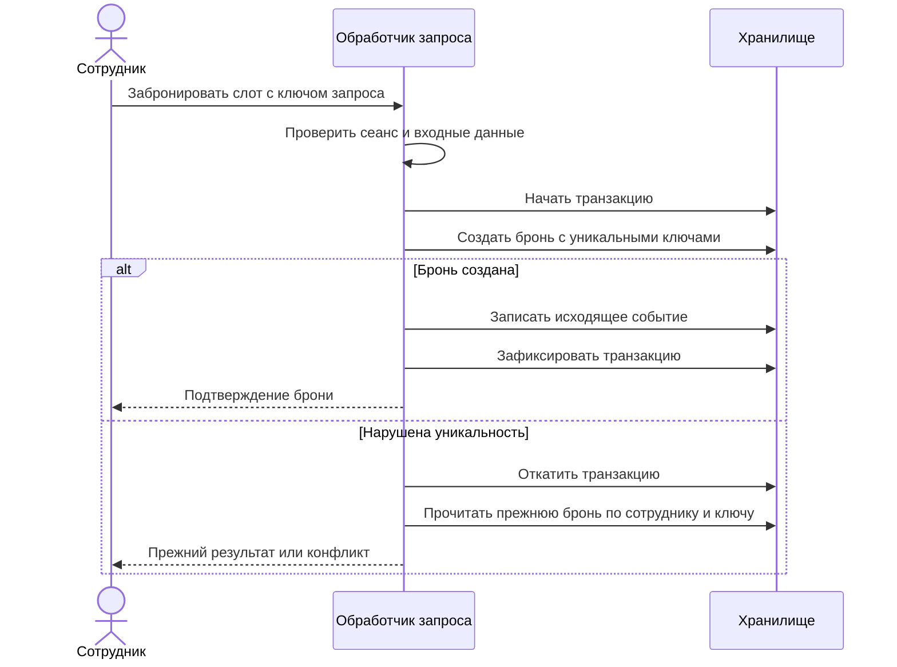

# Модуль бронирования — LLD

> Учебное целевое устройство модуля из [HLD](../hld/README.md).

## Ответственность

Создать бронь для существующего слота, вернуть прежний результат для того же запроса, отклонить конкурирующую бронь. Вход: `slot_id` и ключ запроса; сотрудник определяется по проверенному сеансу. Выход: созданная бронь, повтор прежнего результата либо конфликт.

## Основной сценарий

Если ключ уже существует и `slot_id` совпадает, вернуть ту же бронь. Если ключ связан с другим слотом, вернуть конфликт ключа. Если ключ не найден, но слот занят, вернуть конфликт слота. Чтение после отката выполняется отдельной операцией; особенности изоляции проверяются для выбранной платформенной СУБД.

## Инварианты и отказы

Уникальны `slot_id` и пара `(employee_id, request_key)`; внешняя связь требует существования слота. Бронь и [исходящее событие](../events/booking-created.md) сохраняются одной транзакцией. При её откате не должно остаться ни брони, ни события. При потере ответа после фиксации клиент повторяет запрос с тем же ключом.

## Проверка и диагностика

Проверить конкурентную запись, потерю ответа, изменение параметров при прежнем ключе и отказ записи события. Результаты фиксировать в задаче: версия, команда, фактический результат. Сейчас проверки не выполнены. Считать конфликты отдельно от серверных ошибок; журналировать ID запроса без токена сеанса.

Машинный контракт операции и миграции в учебный комплект не входят; перед реализацией нужны реальные ссылки. [ADR](../decisions/ADR-0101.md) объясняет выбор, [модель данных](../data/booking.md) — ограничения. Референс сценария: [arc42 Runtime View](https://docs.arc42.org/section-6/).
