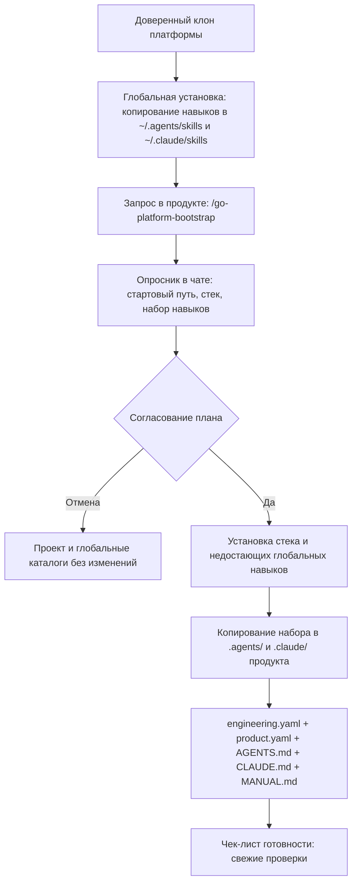
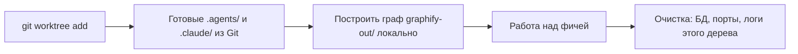

# ADE: управление навыками ИИ

Отдельного установщика для пользователя у платформы нет: настройка описана в
документах (md, yaml); в проектах допускаются и исполняемые скрипты. Все шаги —
файловые операции, git, shell, запуск согласованных скриптов — выполняет агент,
подтверждая план у пользователя; вручную настраивать проект в консоли не
требуется. Приоритет — прозрачность и лёгкая правка последовательности и объёма
действий, а не точная воспроизводимость. Установка и обновление навыков
**всегда требуют явного подтверждения**.

**Нормативное дополнение v17:** порядок разработки и условия переходов задаёт
[SDD-процесс](19-agent-sdd.md); документацию продукта — [контракт артефактов](20-artifact-contract.md).

**В этом документе:** [Жизненный цикл навыков](#ade-lifecycle) · [Где живут навыки](#ade-locations) · [Первый запуск и настройка проекта](#ade-first-run) · [Жизненный цикл worktree](#ade-worktree) · [Собственные навыки продукта](#ade-custom-skills) · [Обновления](#ade-updates) · [Границы безопасности](#ade-security) · [Критерии приёмки](#ade-acceptance)

## Жизненный цикл навыков

## Где живут навыки

| Расположение | Содержимое | Версионирование |
|---|---|---|
| `~/.agents/skills/` | Общие навыки для Codex, Zed и совместимых сред | Глобальная копия; ревизии фиксирует engineering.yaml продукта |
| `~/.claude/skills/` | Те же общие навыки для Claude Code | Та же копия |
| `my-product/.agents/skills/`, `.claude/skills/` | Проектный набор: навыки, агенты, референсы | Отслеживается Git; приоритет над глобальными |
| `my-product/engineering.yaml` | Инженерный профиль: набор, источники, ревизии | Отслеживается Git; источник истины по составу |
| `my-product/AGENTS.md`, `CLAUDE.md` | Русские правила workflow и приоритета проектных навыков | Отслеживается Git |
| `my-product/graphify-out/` | Локальный граф кода | Игнорируется Git; каждое дерево строит само |

Наличие навыка в глобальном каталоге не означает его обязательное применение:
каждый продукт использует только зафиксированный в engineering.yaml набор, и инструкции
одного продукта не распространяются на другой.

## Первый запуск и настройка проекта

Установка на новую машину и порядок настройки продукта описаны в
[platform-installation.md](../references/platform-installation.md):
одна глобальная установка из доверенного клона, затем один запрос в целевом
продукте — `/go-platform-bootstrap` без текста задачи
(в Codex — `$go-platform-bootstrap` или выбор скилла). Дальше работает опросник
в чате: агент задаёт по одному вопросу, показывает план и выполняет настройку сам.
Пользователь не вводит команды и не выбирает технические имена профилей.

Запросы на естественном языке после настройки обслуживает проектный навык
`go-project-platform-manager` (устанавливается в `.agents/skills/` и
`.claude/skills/` продукта):

| Запрос пользователя | Что делает агент | Граница безопасности |
|---|---|---|
| «Какие навыки у нас есть?» | С согласия осматривает глобальные каталоги и сверяет с engineering.yaml | Ничего не меняет |
| «Включи ещё навыки тестирования» | Предлагает изменение набора, копирует в `.agents/` и `.claude/` | Только после подтверждения |
| «Установи недостающие глобально» | Показывает точные источники и клонирует их | Отдельное согласие на глобальные каталоги |
| «Проверь обновления» | Сравнивает ревизии engineering.yaml с источниками | Только чтение, ничего не применяет |
| «Обнови эти навыки» | Показывает изменения и влияние на другие проекты | Отдельное согласие; затрагивает все продукты машины |
| «Проверь готовность» | Чек-лист готовности по MANUAL.md с фактическими командами | Без изменения глобальных каталогов |

## Жизненный цикл worktree

Проектные материалы `.agents/` и `.claude/` отслеживаются Git, поэтому новый
worktree получает набор автоматически — без установки, сети и обновления навыков.

Граф Graphify — генерируемый материал: каждое дерево строит его по инструкции
проектного навыка Graphify. Локальный `.canvas/`, если используется, также
восстанавливается отдельно по [инструкции canvas](../references/canvas-installation.md);
граф и runtime не входят в отслеживаемый набор навыков.

## Собственные навыки продукта

Навык создаётся тогда, когда появляется реально уникальное проектное правило,
нестандартная интеграция или повторяемый сценарий — а не потому, что он
предусмотрен каталогом. Проектные навыки живут в `.agents/skills/` и
`.claude/skills/` под Git. Если навык должен переиспользоваться другими
продуктами, его осознанно переносят в общий набор платформы с источником и
ревизией — это отдельное решение, а не автоматическое действие.

## Обновления

Проверка обновлений — только чтение: сравнение ревизий engineering.yaml с источниками
(локальные клоны или `git ls-remote`). Применение — отдельная операция с явным
согласием, потому что глобальное обновление влияет на **все** продукты машины.
Перед применением агент обязан показать:

- какие навыки и проекты потенциально затронуты;
- источник и прежнюю/предлагаемую ревизию;
- меняются ли команды установки или запуска скриптов;
- план проверки после обновления и способ восстановления прежнего снимка;
- что Graphify и Orca обслуживаются собственными механизмами
  (`uv tool upgrade graphifyy`, встроенный updater Orca) независимо от Git-ревизий.

Проектные копии не меняются от глобального обновления: их обновляют отдельно,
показав список для согласования и обновив engineering.yaml. Новые имена навыков добавляются
правкой [каталога источников навыков](../skills/go-platform-bootstrap/references/skill-sources.md),
а не непроверенным автоматическим поиском.

## Границы безопасности

- **Глобальные каталоги изменяются только с явного согласия**: простая просьба
  «проверить» не разрешает установку или обновление.
- **Профиль — источник истины**: состав набора продукта фиксируется в
  `engineering.yaml`; всё, что вне профиля, не считается частью набора.
- **Проектные копии имеют приоритет** над глобальными и изолируют продукт от
  чужих обновлений.
- **Чужие навыки не перезаписываются**: при конфликте имён установка останавливается
  без принудительной замены.
- **Скрипты сторонних навыков не запускаются автоматически** и не получают секреты
  рабочей среды.
- **Изоляция деревьев**: глобальные навыки — руководства; БД, порты, логи и графы
  не общие между worktree.

## Критерии приёмки

| Инвариант | Проверка |
|---|---|
| Пользователь отменил опросник | Никаких изменений в проекте или глобальных каталогах |
| Пользователь отказал в осмотре глобальных каталогов | Осмотр пропущен, план составлен без него |
| Навык активирован для проекта | Обновлены engineering.yaml и копии в `.agents/`/`.claude/`; глобальные каталоги без изменений |
| Глобальный навык отсутствует | Показан источник, установка только с отдельным подтверждением |
| Пользователь попросил «проверь обновления» | Только отчёт о ревизиях, ничего не применяется |
| Источник изменился после согласования | Обновление отменено, требуется новое согласование |
| Конфликт с существующим навыком | Никакой принудительной перезаписи |
| Появился новый worktree | Набор уже в Git; строится только локальный граф |
| Уже есть собственный проектный навык | Он сохраняется при повторной настройке |

**Результат:** пользователь управляет навыками обычными сообщениями в ADE, а не
терминальными командами. Агент обязан объяснять последствия, получать подтверждение
и проводить фактические операции с проверяемыми результатами.

Источники: [Orca skills/updater](https://orca.dev/docs/cli/skills) · [Vercel Навыки агентов CLI](https://github.com/vercel-labs/skills/blob/main/docs/commands.md) · [Graphify](https://github.com/Graphify-Labs/graphify) · [Addy Osmani Навыки агентов](https://github.com/addyosmani/agent-skills).

## Выбор ADE и перенастройка исполнителей

[Единая инструкция ADE](../references/ade-installation.md) содержит настройку
Codex, Claude Code, OpenCode, Orca и Zed. Пользователь выбирает набор сред и основную;
для Orca/Zed отдельно определяется исполнитель. Настраиваются только выбранные
интеграции. Опрос использует нативные формы и варианты, при отсутствии multi-select —
шаги выбора; ограничения и текстовый fallback описаны в том же документе.

Общий снимок платформы переносим между средами. Семь ролей и реальные назначения
фиксирует engineering.yaml schema 1.2; выбор ADE — surfaces/primary_surface,
исполнители — harnesses/assignments. Изменение предпочтений не требует повторного
bootstrap и не удаляет пользовательские настройки. Контракт и миграция —
[модели и харнесы](../references/model-harness-configuration.md).

---

Навигация: [← 14. Навыки ИИ](14-skills-catalog.md) · [Оглавление](README.md) · [16. Совместимость и ADR →](16-evolution-adrs.md)
