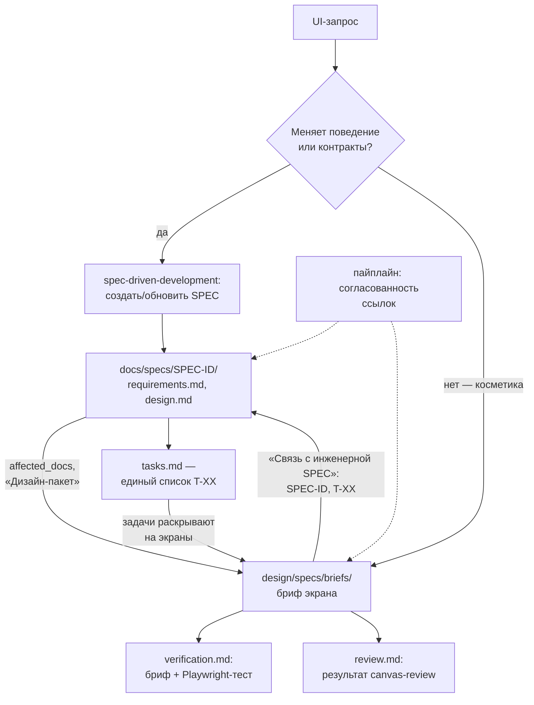

# Опциональный canvas для UI/фронтэнда

Источник: [app-canvas](https://gitlab16.skiftrade.kz/design/app-canvas), официальный
`canvas_setup.py`. Canvas предлагается при первоначальной настройке любого продукта
с UI и может быть подключён позднее. Альтернатива —
[общий набор UI-навыков](prototyping-installation.md) для целевого интерфейса
и экспериментов. Целевая документация — docs/ui; прототипы создаются отдельно
в prototypes/PROTOTYPE-NNNN-slug. Выбор фиксируется в engineering.yaml. Для backend-only
проекта инструменты UI можно пропустить.

1. Уточнить, создаётся ли интерфейс или подключается существующее приложение.
2. Получить исходники в новую временную папку через Git с доступом к корпоративному
   GitLab; использовать SSH или HTTPS согласно настройкам пользователя.
3. Прочитать README и установщик выбранной ревизии. Показать план: `.canvas/`,
   `design/`, возможная установка Node.js, npm-зависимостей и адаптеров агентов.
4. После согласования запустить официальный установщик из проверенного клона
   в корне Git продукта:

```sh
git clone --depth 1 https://gitlab16.skiftrade.kz/design/app-canvas.git /tmp/app-canvas-installer
# После проверки исходников агент запускает установщик сам, по согласованному плану:
python3 /tmp/app-canvas-installer/canvas_setup.py   # из корня продукта
# Для существующего приложения указать его путь относительно корня продукта.
# Для нового приложения выбрать кит и цвет по согласованию с пользователем.
# Официальный установщик позволяет указать опубликованную версию (tag) canvas.
```

Укажите свободную временную папку; не удаляйте чужой клон при совпадении имени.
Установку запускает агент из проверенного локального клона, а не скачивает и
исполняет неизвестный скрипт автоматически. Официальный установщик сам загружает
опубликованную версию canvas; SHA локального установщика не фиксирует версию runtime.
Без доступа к GitLab установка откладывается с указанием причины.

`.canvas/` — локальный инструмент вне Git; `design/` — отслеживаемый дизайн-пакет
продукта. `design/specs` дополняет инженерную SPEC, связывается с ней ссылками и не
заменяет `docs/specs/<SPEC-ID>/` и единый список `tasks.md`.
Общие навыки остаются глобальными; собственные адаптеры canvas устанавливаются его
штатным механизмом. Не копировать наборы навыков вручную.

Связь с инженерной SPEC — двусторонние ссылки между отслеживаемыми документами.
Из SPEC в дизайн: поле `affected_docs` или раздел «Дизайн-пакет» в
`requirements.md` и `design.md` перечисляет затронутые брифы
`design/specs/briefs/`. Из брифа в SPEC: секция «Связь с инженерной SPEC»
содержит путь `docs/specs/<SPEC-ID>/` и задачи `T-XX` из единого `tasks.md`.
Канвасные команды не ведут второй список задач — они раскрывают задачи SPEC
на экраны.

Маршрутизация UI-запроса: изменение поведения или контрактов сначала проходит
`spec-driven-development` (создание или обновление SPEC), затем бриф ссылается
на неё; косметика и экран без логики — бриф без SPEC, при появлении SPEC ссылка
добавляется в бриф и `affected_docs`. Для критериев с UI в `verification.md`
приводят бриф и реальный Playwright-тест; в `review.md` указывают
результат `canvas-review`, записанный в брифе. Согласованность ссылок — каждый
SPEC-ID из `design/specs/` существует в `docs/specs/`, у SPEC с UI-задачами есть
бриф — проверяет пайплайн продукта.



После установки из корня продукта выполнить шаги, напечатанные установщиком,
`python3 .canvas/board.py doctor`, затем `python3 .canvas/board.py serve` и сообщить
фактический адрес доски. Если кит не выбран, выбрать его в первой UI-задаче.
После установки или обновления Canvas проверить совместимость Git-хуков с
Graphify по [инструкции](graphify-installation.md#3-git-хуки-и-canvas): оба
обработчика должны реально выполняться, существующий hooksPath сохраняется.
Ошибки doctor фиксировать явно; завершение установщика ещё не означает готовность UI.
Создание worktree не запускает установку или обновление canvas: `.canvas/` —
локальный материал дерева, `design/` приходит из Git.

## Удаление и замена

Для запроса «убрать canvas и заменить прототипами» управляющий навык выполняет
[сценарий миграции](prototyping-installation.md#замена-canvas-на-прототипы).
Удаление `.canvas/` само по себе недостаточно: сначала перенести дизайн-материалы,
проверить замену, затем отключить интеграции с сохранением Graphify и других хуков.
