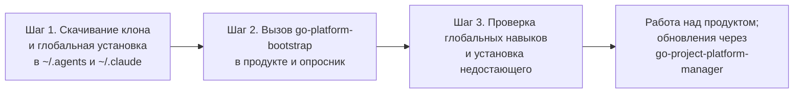

# Установка платформы и жизненный цикл навыков

У платформы нет интерактивного установщика: установку выполняет агент —
копирование материалов из доверенного клона в глобальные каталоги по документам
платформы. Все дальнейшие действия агент выполняет сам; пользователь не
настраивает проект в консоли вручную.

## Последовательность установки

Установка платформы и подготовка продукта — три шага. Каждый шаг ведёт агент;
пользователь подтверждает выборы в чате и не выполняет установку вручную.

### Шаг 1. Скачивание репозитория и глобальная установка навыков

Скачайте (склонируйте) репозиторий go-product-platform — это доверенный клон;
его ревизию фиксируют в отчёте установки. Затем попросите агента: «Установи
навыки Go Product Platform глобально из этого клона». Агент по
[инструкции операций](../skills/go-platform-bootstrap/references/commands.md)
устанавливает **три навыка платформы** — `go-platform-bootstrap`,
`go-project-platform-manager` и `go-product-modernization` — и полный снимок материалов для всех
поддерживаемых агентских сред (Codex, Claude Code, OpenCode, Zed, Orca):

1. Подготавливает переносимый набор по разделу
   [«Переносимый набор платформы»](#переносимый-набор-платформы) в `~/.agents/`
   и `~/.claude/` из одной согласованной ревизии платформы. Два глобальных
   каталога покрывают все перечисленные среды: `~/.agents/` — Codex, OpenCode, Zed, Orca
   и совместимые; `~/.claude/` — Claude Code.
2. Проверяет ссылки и наличие материалов в обоих установленных наборах,
   не полагаясь на доступность исходного клона.
3. Сообщает, какие каталоги созданы, и предлагает перечитать список skills или
   перезапустить агент ADE: обнаружение глобальных навыков зависит от среды.

Собственные Orca-навыки (`orca-cli`, `orchestration` и другие) на этом шаге не
ставятся: они устанавливаются собственным механизмом Orca по потребности
проекта на шаге 3.

### Шаг 2. Вызов go-platform-bootstrap и опросник

Откройте целевой Git-продукт и вызовите команду `/go-platform-bootstrap`;
в Codex используйте `$go-platform-bootstrap` или выбор скилла. Slash-вызов
доступен только в поддерживающих его ADE; сценарий после вызова одинаковый.

Агент проводит пользователя по шагам
[опросника настройки](../skills/go-platform-bootstrap/references/questionnaire.md).

После глобальной установки агент при настройке читает навык
`~/.agents/skills/go-platform-bootstrap/SKILL.md`; для уже настроенного проекта —
управляющий навык `.agents/skills/go-project-platform-manager/SKILL.md`.
Перед любыми глобальными проверками, установками или обновлениями агент
запрашивает разрешение.

### Шаг 3. Проверка глобальных навыков и установка недостающих

На шаге «Инвентаризация» опросника (с согласия пользователя) агент проверяет
перечень установленных глобальных навыков во всех каталогах агентских сред
(`~/.agents/skills/`, `~/.claude/skills/`) и версии инструментов продукта, чтобы
использовать существующее и установить только недостающее — в соответствии
с потребностями проекта. Расположение наборов и границы операций —
[skills-installation.md](skills-installation.md); источники, пути в клонах и
фиксация ревизий —
[каталог источников навыков](../skills/go-platform-bootstrap/references/skill-sources.md).

Часть источников требует установки большего, чем только каталог навыка:

- **addyosmani/agent-skills** — источник всех навыков и настроек процесса — помимо
  `skills/<имя>` содержит общие референсы `references/`; они копируются в
  `.agents/references/` и `.claude/references/` продукта. Референсы и шаблоны
  процесса входят во все профили, включая `custom`.
- Полный цикл Graphify — [обязательная интеграция](graphify-installation.md):
  область анализа, первоначальный граф, хуки, инструкции агента и проверка обновления.
- **Graphify** — утилита (`uv tool install graphifyy`) плюс навык по инструкции
  репозитория; входит во все профили.
- **Orca** — навыки устанавливаются только собственным официальным механизмом
  Orca, не ручным копированием.
- **Общий набор UI** — для целевого приложения и экспериментов: выбранные навыки
  прямо в оба проектных каталога на зафиксированных SHA, без обязательной
  глобальной установки; [инструкция](prototyping-installation.md).
- **app-canvas** — отдельная установка официальным установщиком
  ([canvas-installation.md](canvas-installation.md)): `.canvas/`, `design/`,
  возможная установка Node.js, npm-зависимостей и адаптеров агентов.

После установки недостающего глобально агент копирует согласованный набор в
продукт (`.agents/` и `.claude/`) и фиксирует состав и ревизии в
`engineering.yaml` — см. раздел
[«Проектный набор агентных материалов»](#проектный-набор-агентных-материалов).

**Предметные навыки разрабатываемого продукта на этом шаге не устанавливаются
и не требуются.** Настройка ставит только навыки платформы, процесса и стека из
каталога источников. Собственный навык продукта (например, поиск планограмм)
появляется позже — когда в разработке возникает реально уникальное проектное
правило, нестандартная интеграция или повторяемый сценарий
([глава 15 handbook, «Собственные навыки продукта»](../handbook/15-ade-platform.md#собственные-навыки-продукта)).
Такой навык живёт в `.agents/skills/` и `.claude/skills/` продукта под Git и не
публикуется глобально без отдельного явного запроса пользователя.

## Переносимый набор платформы

Одинаковая структура применяется глобально (`~/.agents/`, `~/.claude/`) и
в продукте (`.agents/`, `.claude/`). Ниже `ROOT` означает один из этих каталогов.

| Источник в клоне | Назначение |
|---|---|
| `README.md`, `CHANGELOG.md`, весь `platform/` | `ROOT/references/go-product-platform/`, с сохранением дерева клона |
| `platform/skills/go-platform-bootstrap/` | `ROOT/skills/go-platform-bootstrap/` |
| `platform/skills/go-project-platform-manager/` | `ROOT/skills/go-project-platform-manager/` |
| `platform/skills/go-product-modernization/` | `ROOT/skills/go-product-modernization/` |

Снимок содержит handbook, constitution, шаблоны, инструкции и исходные навыки.
Не копируйте `.git/`, временные файлы и секреты. Не используйте абсолютные пути
к исходному клону или симлинки: проектный набор должен работать после checkout
на другой машине. При копировании из глобального набора берите исходные навыки
из его снимка `references/go-product-platform/`, а не уже преобразованные копии.

В снимке ссылки остаются исходными. В двух каталогах `ROOT/skills/` агент
пересчитывает относительные пути в Markdown-ссылках и путевых полях frontmatter:

1. Разрешить путь относительно исходного файла в клоне или снимке.
2. Если цель внутри одного из трёх устанавливаемых навыков, использовать её
   новое расположение в `ROOT/skills/`; иначе — в `ROOT/references/go-product-platform/`.
3. Записать относительный путь от установленного файла к установленной цели,
   сохранив фрагмент `#…`. Внешние URL, ссылки только на якорь и ID не менять.

Например, ссылка bootstrap `../../templates/` становится
`../../references/go-product-platform/platform/templates/`, а ссылка его
`SKILL.md` на `../../references/canvas-installation.md` —
`../../references/go-product-platform/platform/references/canvas-installation.md`.

После копирования проверить все локальные ссылки и якоря в установленном наборе,
включая handbook и шаблоны. Проверить одинаковый состав и ревизии наборов `.agents` и `.claude`;
платформенные сборки внешних навыков могут различаться ресурсами и адаптерами.
Ревизию снимка и трёх навыков записать в engineering.yaml продукта; для глобальной установки
без продукта — в отчёт установки с SHA. Не приписывать грязному клону чистый SHA:
согласовать зафиксированный снимок либо явно записать SHA базы и локальный diff.
Существующие пользовательские изменения не перезаписывать; обновление снимка и
навыков согласовывать вместе. Проектный снимок хранится в Git и не зависит от глобального.

## Проектный набор агентных материалов

После согласования списка (навыки, агенты, референсы, пути, ревизии) агент
копирует материалы в `.agents/` и `.claude/` продукта и фиксирует состав набора в engineering.yaml.
Эти копии хранятся в Git и имеют приоритет над глобальными. Корневые AGENTS.md
и CLAUDE.md требуют на русском соблюдать процесс разработки.
MANUAL.md содержит настройку, окружение, запуск и проверки конкретного продукта.

## Выбор ADE и моделей

При настройке заполнить семь назначений ролей по
[контракту моделей и харнесов](model-harness-configuration.md); UI-документы и
эксперименты создаются по [общему UI-процессу](prototyping-installation.md).
Выбрать одну или несколько сред и основную ADE по [единой инструкции](ade-installation.md):
Codex, Claude Code, OpenCode, Orca, Zed. Для Orca/Zed определить исполнителя.
Нативные конфигурации создавать только для выбранных интеграций; переносимый
снимок `.agents/` и `.claude/` не означает установку всех ADE. Предпочтения
фиксируются в ai.surfaces/primary_surface, их можно изменить управляющим навыком.
Опрос — через [нативные формы](ade-installation.md#интерактивный-выбор-пользователя),
с последовательными опциями при отсутствии multi-select и текстовым fallback.
В составе фиксировать фактические config_paths; исходный снимок платформы включает
новые справочники и шаблоны. При упаковке шаблонов пересчитать также их ссылки.

## Разрешения и границы

- `~/.agents/skills` и `~/.claude/skills` — глобальные каталоги пользователя;
  изменения только после явного согласия.
- Состав набора продукта отслеживается в engineering.yaml
  и копиях в `.agents/`, `.claude/` под Git; проектные версии имеют приоритет
  и не меняются от глобальных обновлений.
- Работа в worktree не требует установки: проектные материалы приходят из Git;
  каждое дерево само строит генерируемые артефакты (например, граф graphify).
- Скрипты сторонних навыков никогда не запускаются автоматически.

## Обновления

Проверку состава, выбор навыков и обновления ведёт проектный управляющий навык
[go-project-platform-manager](../skills/go-project-platform-manager/SKILL.md)
(в настроенном продукте — `.agents/skills/go-project-platform-manager/SKILL.md`).

Проверка выполняет только чтение: сравнение ревизий engineering.yaml с источниками.
Применение — отдельная операция, требующая одобрения; прежние снимки сохраняются
для восстановления. Сторонние артефакты обновляются собственными механизмами:
Orca — встроенный updater, Graphify — `uv tool upgrade graphifyy`, app-canvas —
повторный запуск официального установщика с указанием опубликованной версии
([canvas-installation.md](canvas-installation.md)). Новые имена навыков
добавляются правкой
[каталога источников навыков](../skills/go-platform-bootstrap/references/skill-sources.md),
а не непроверенным автоматическим поиском.
