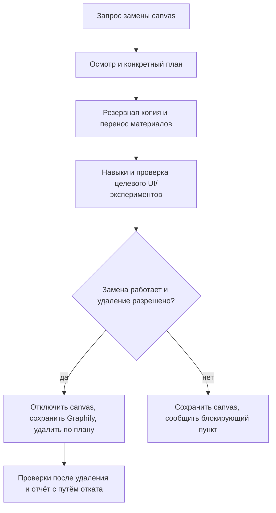

# Разработка UI и экспериментальные прототипы

Набор применяется к **целевому интерфейсу продукта и экспериментальным прототипам**.
Прототип проверяет идею или гипотезу; он не является первой версией продукта
и не превращается в неё простой заменой mock API. В целевое приложение переносятся
принятые UX-решения; пригодность кода оценивается отдельно.

При настройке выбрать `ui.mode`: `skills`, `canvas`, `none` или явно `both`.
`skills` включает общий UI-набор, `both` — его и Canvas. Создание прототипов —
независимый выбор `ui.prototypes.enabled`, доступный в любом режиме; при `none`
дополнительный UI-набор не устанавливается. Режим не определяет путь приложения.
Целевой UI остаётся в `web/`, `frontend/` или фактическом пакете продукта.
Обычная смена режима ничего не удаляет. Старое значение `prototype` мигрируется
по разделу ниже. Имя этого справочника сохранено для совместимости ссылок.

## Установка проектного набора

1. Проверить целевую платформу, приложение, kit, токены и существующие документы.
   Выбрать основу и дополнения из
   [каталога](../skills/go-platform-bootstrap/references/skill-sources.md#скиллы-для-разработки-прототипов).
   Показать назначение, источник, SHA, ресурсы и пути каждого навыка.
2. Включить Impeccable из `https://github.com/pbakaus/impeccable` в основу `skills`/`both`.
   Проверить README и `SKILL.md` выбранной ревизии. Он ведёт дизайн и итерации;
   дополнительные designer/reviewer-навыки выбирать с явным разделением ролей.
3. Копировать переносимые сборки на фиксированном SHA непосредственно в
   `.agents/skills/` и `.claude/skills/` корня продукта с ресурсами и лицензиями.
   Глобальная установка не обязательна. OpenCode использует `.agents/skills/`;
   его адаптеры — по [инструкции OpenCode](ade-installation.md#opencode).
   Совпадения имён и пользовательские изменения проверять по diff, не перезаписывать.
4. Для Impeccable брать сборку соответствующей ADE, включая `reference/`, scripts
   и остальные необходимые ресурсы. Копирование одного `SKILL.md` недостаточно.
   По [upstream README](https://github.com/pbakaus/impeccable#installation) ручная
   копия не устанавливает hooks и subagents; OpenCode также может требовать
   отдельную команду. Указать в плане engine/runtime, способ установки и хуки;
   проверить совместимость с выбранной ADE. Сторонние скрипты запускать только
   в разрешённом объёме. Не выдавать наличие файлов за работоспособность runtime.
5. Записать source, revision, paths, purpose, status в `engineering.yaml`;
   версии runtime и результаты проверки — в MANUAL. Различия сборок ADE допустимы,
   но источник и ревизия должны совпадать. Локальный изменённый Impeccable сохранить
   и сравнить с upstream; не выдавать его за чистую upstream-ревизию.
6. В AGENTS.md включить маршрут: UI-контекст → дизайн → реализация → независимое
   дизайн-ревью → проверки. Модели и харнесы брать из `ai.roles`; CLAUDE.md
   ссылается на AGENTS.md, OpenCode читает AGENTS.md. Проверить обнаружение навыков
   в каждой выбранной ADE, ссылки и ресурсы. CLI visual QA и браузеры проверять отдельно.

Установка навыков не создаёт приложение автоматически. В плане отдельно указать
целевой UI, документацию и конкретные эксперименты. Без гипотезы не создавать
фиктивный PROTOTYPE; технический smoke относится к настройке целевого приложения.

## Документация целевого UI

```text
docs/ui/
  DESIGN.md
  SPEC-0001-bootstrap/
    vision.md
    components.md
    screens.md
```

- `DESIGN.md` — единая дизайн-система целевого продукта: kit, токены, типографика,
  сетка, состояния, доступность, адаптивность и движение; ссылки на реализацию.
- `vision.md` — аудитория, задача, принципы и направление дизайна фичи, ограничения,
  ссылки на требования, прототипы и принятые/отклонённые гипотезы.
- `components.md` — композиции фичи, варианты, состояния, взаимодействия,
  доступность и пути компонентов; общие правила берутся из DESIGN.md.
- `screens.md` — экраны, маршруты, сценарии, переходы, loading/empty/error/success,
  права доступа и адаптация к размерам экрана.

Каталог фичи **совпадает с именем** `docs/specs/SPEC-0001-bootstrap/`;
отдельная нумерация UI-SPEC не вводится. Документы имеют уникальные ID
`UI-DESIGN`, `UI-SPEC-0001-vision`, `UI-SPEC-0001-components`, `UI-SPEC-0001-screens`
и `kind: "design"` по [контракту артефактов](../handbook/20-artifact-contract.md).
Связать их с реальным ID инженерной SPEC и включить в `affected_docs`.
Требования, AC, задачи, verification и review остаются в инженерной SPEC;
UI-документы не создают второй backlog. Дизайн-ревью записывается в её `review.md`.

Создавать документы с предметным содержанием при разработке целевого UI, до
реализации соответствующей фичи; поддерживать вместе с кодом. При UI-bootstrap
оформить инженерную SPEC и её UI-пакет, если начата эта работа. Для настройки
только инструментов не создавать фиктивную bootstrap-фичу. Шаблоны —
[templates/ui](../templates/ui/README.md).

Impeccable и другие навыки должны читать канонический `docs/ui/DESIGN.md`.
Если версия инструмента обнаруживает только корневой DESIGN.md, создать тонкий
указатель на этот файл и проверить, что агент прочитал цель. Не заводить вторую
редактируемую дизайн-систему. PRODUCT.md при необходимости служит кратким контекстом
со ссылками на product.yaml и действующие требования, не дублирует их как новый
источник истины. Записи `document`/`extract` переносить в канонический документ.

## Единый стек и несколько прототипов

По умолчанию для всех экспериментов одного продукта согласовать один стек:
React + TypeScript + Vite, shadcn/ui + Base UI, Tailwind с семантическими токенами.
Для маршрутов, данных, форм и mock при необходимости использовать TanStack Router,
TanStack Query, React Hook Form + Zod, MSW либо in-memory adapter. Storybook —
опциональный каталог компонентов. Версии и совместимость проверять при установке,
сохранять lockfile; не мигрировать существующий kit автоматически.

Этот стек не обязан совпадать с целевым: web-прототип может проверять идею native
продукта. Для гипотез о native-поведении выбрать общий native стек экспериментов
или явно обозначить пределы web-симуляции. Решение фиксируется в
`ui.prototypes.stack`; стек целевого UI — в `ui.target.stack`.

```text
prototypes/
  PROTOTYPE-0001-checkout/
    README.md           # гипотеза, критерий успеха, запуск, результат и решение
    DESIGN.md           # только экспериментальное направление и отличия
    src/
    package.json
    <lockfile>
  PROTOTYPE-0002-navigation/
    README.md
    DESIGN.md
    src/
```

Прототипы размещаются в `prototypes/` в корне продукта; каждый эксперимент —
в отдельном каталоге. В профиле `ui.prototypes.root: "prototypes"`, шаблон
`ui.prototypes.naming: "PROTOTYPE-{number:04d}-{slug}"` задаёт имя внутри него.
Пути в `ui.prototypes.items` указываются относительно корня репозитория,
например `prototypes/PROTOTYPE-0001-checkout`.
Номер уникален среди экспериментов,
не переиспользуется после архивации и не связан с номером SPEC. Перед созданием
проверить существующие каталоги и реестр `ui.prototypes.items`. Независимые
зависимости/порты/данные не должны конфликтовать; в workspace допустим общий
lockfile и общие пакеты, если эксперимент не меняет целевые компоненты без ревью.

README каждого прототипа фиксирует гипотезу, аудиторию, сценарий, критерий успеха,
ограничения mock, фактические наблюдения и решение: продолжить, принять, отклонить.
До проверки решение — «не проверено». Реестр хранит id, path, status
(`draft`, `testing`, `accepted`, `rejected`, `archived`), target_specs — ссылки на
реальные инженерные SPEC либо пустой список. Прототип может дать несколько фич,
а одна фича — опираться на несколько прототипов.

Для эксперимента достаточно README и проверок гипотезы; шесть документов SPEC
не требуются, пока не меняется целевой продукт. Проверить запуск без backend,
основной сценарий, build/typecheck и визуально то, что важно гипотезе. Для сложных
взаимодействий добавить сценарные проверки. Mock не является проверкой реального API.

## Перенос решений и готовность целевого UI

1. Зафиксировать результат эксперимента и решение в README; не объявлять гипотезу
   подтверждённой только потому, что приложение собирается.
2. Перенести принятые требования в инженерную SPEC, дизайн — в `docs/ui/<SPEC>/`;
   связать оба направления с прототипом. Обновить DESIGN.md только для общих решений.
3. Реализовать целевой интерфейс на стеке продукта. Код прототипа переносить только
   после проверки архитектуры, зависимостей, kit, лицензий и качества. Не подключать
   production-сборку к каталогам PROTOTYPE или их mock-данным.
4. Выполнить typecheck/build, сценарные и accessibility-проверки (Playwright/axe-core
   для web), ручную клавиатурную и визуальную проверку. Проверить состояния,
   адаптивность, контраст, focus и reduced motion. Desktop проверять в настоящем
   окне, native — на соответствующей платформе. API и авторизацию проверять с
   реальной интеграцией; mock-результаты обозначать отдельно.
5. Независимый рецензент роли `design_review` проверяет работающий UI и docs/ui;
   `code_review` проверяет код. Результаты, ограничения и фактические исполнители —
   в review/verification инженерной SPEC, команды — в MANUAL.

## Миграция прежнего UI-профиля

Существующее `ui.mode: prototype` трактовать как прежний общий UI-набор; при
перенастройке заменить на `skills`, сохранив навыки. `canvas`, `none` и `both`
сохраняют смысл. Новый профиль — engineering schema 1.2; product.yaml не меняется.
Осмотреть `ui.prototype_path`/`prototype/`: если там целевое приложение, записать
его в `ui.target.path` и оставить на месте; если эксперимент — включить в items,
сохранив путь до согласованного переноса в `prototypes/PROTOTYPE-NNNN-slug`. Не угадывать назначение
по имени папки. Удалять старое поле только после переноса его значения.
Перенос исправляет imports, workspace, CI, команды и ссылки; существующие
дизайн-материалы переносятся с сохранением содержания. Миграция повторяема:
не дублирует записи/ID и не перезаписывает пользовательские файлы.
Прежние PROTOTYPE-каталоги из корня также переносятся в `prototypes/` с сохранением
номеров; обновить items, ссылки, workspace/CI и команды запуска. Перед переносом
проверить отсутствие конфликта с уже существующим каталогом назначения.

## Замена canvas на прототипы

Точка входа — `go-project-platform-manager`. Запрос «убрать canvas и заменить
его разработкой UI через прототипы» означает миграцию, а не только смену `ui.mode`.
Агент выполняет работу сам. Простой выбор `skills` или запрос «проверить»
не разрешает удаление canvas. Уже согласованный перечень действий повторного
подтверждения не требует; неопределённые пользовательские данные сохраняются.

### 1. Инвентаризация и план

Прочитать `engineering.yaml`, инструкции ADE и MANUAL; проверить Git status,
отслеживаемые, неотслеживаемые и игнорируемые файлы. Найти `.canvas/`, `design/`,
реальное приложение и его связь с canvas, адаптеры/навыки в выбранных ADE,
package scripts, зависимости, lockfile, CI, `.gitignore`, `.graphifyignore`,
ссылки из SPEC и команды запуска. Искать также в скрытых конфигурациях;
не выводить секреты и не считать все файлы `design/` служебными.

Проверить `git worktree list`, эффективный `core.hooksPath` с источником настройки,
`git rev-parse --git-path hooks` и обработчики по
[правилам Graphify](graphify-installation.md#3-git-хуки-и-canvas).
Отличать локальные файлы текущего дерева от общих hooks/config и симлинков.

Показать конкретный план таблицей:

| Объект / фактический путь | Действие | Куда переносится / резервная копия | Проверка |
|---|---|---|---|
| Брифы, токены, изображения, решения | Перенести или сохранить | `docs/ui/`, README, assets либо архив | Содержимое и ссылки SPEC сохранены |
| Приложение и общие компоненты | Переиспользовать | Целевой пакет или отдельный PROTOTYPE | Сценарии и сборка |
| Canvas runtime и адаптеры | Удалить после проверки замены | Внешняя резервная копия | Нет активных вызовов |
| Хуки, scripts, CI, инструкции | Убрать только интеграцию canvas | Копия исходной конфигурации | Graphify и другие обработчики работают |

Заполнить таблицу обнаруженными путями, перечислить точный объём удаления,
выбранные навыки/SHA, создание или перенос приложения и команды проверки.
При недостаточно определённом разрешении подготовить переносимые материалы
и diff, затем согласовать конкретное удаление перед его выполнением.
Не выдавать типовую таблицу за результат осмотра.

### 2. Подготовка замены и восстановления

- Сохранить резервную копию изменяемых локальных/игнорируемых файлов canvas,
  хуков и конфигурации вне удаляемых каталогов и вне отслеживаемого дерева.
  Записать абсолютный путь, исходную ревизию Git и перечень файлов; проверить,
  что копия читается и соответствует исходникам. Незакоммиченные изменения
  сохранять отдельно: одного SHA для восстановления недостаточно.
- Установить общий UI-набор. Принятые дизайн-решения перенести в `docs/ui/`,
  экспериментальные — в соответствующий PROTOTYPE. Сохранить assets и связи SPEC;
  исторические брифы можно оставить архивом без runtime canvas.
- Существующее целевое приложение оставить в его пакете и записать `ui.target.path`.
  Эксперименты записать в `ui.prototypes.items`; перенос папок — только по плану,
  с исправлением импортов, workspace-путей, CI и команд. Не превращать приложение
  в прототип из-за смены инструмента дизайна.
- Проверить замену до удаления: запуск без canvas (для прототипа также без backend), основной сценарий,
  typecheck/build, Playwright/axe-core и UI review по критериям выше. Если запрос
  ограничен сменой инструментов без приложения, проверить навыки и маршрутизацию,
  сохранить исходники UI и явно указать эту границу готовности.

### 3. Отключение и удаление canvas

После успешной проверки замены выполнить разрешённый план:

1. Остановить только подтверждённый процесс canvas текущего проекта; не завершать
   все Python/Node-процессы. Убрать его автозапуск, scripts и CI-вызовы.
2. В эффективных хуках удалить только вызовы/блоки canvas. Сохранить Graphify,
   другие обработчики, executable-биты, аргументы, stdin и обработку ошибок.
   Не сбрасывать `core.hooksPath` и не удалять dispatcher целиком. Если общий
   обработчик нужен другим worktree/репозиториям, сохранить его для них и
   отключить canvas только для мигрируемого дерева. Не менять общие настройки
   за пределами согласованной области; нерешённую общую зависимость отметить явно.
3. Удалить только перечисленные в плане runtime-файлы `.canvas/` и исключительно
   canvas-адаптеры/навыки из проектных ADE. Общие навыки и глобальные
   установки сохраняются. Симлинк удалять как ссылку, не удаляя внешний target.
   `design/` удалять только после переноса/архивации всех нужных материалов и
   проверки ссылок; сам каталог не является признаком ненужных данных.
4. Убрать неиспользуемые canvas-зависимости штатным package manager с обновлением
   lockfile; сохранить общие зависимости приложения. Удалить только относящиеся
   к canvas правила ignore, устаревшие команды и обязательные проверки doctor.
5. Обновить `engineering.yaml`: `ui.mode: skills`, ui.target, ui.prototypes и kit,
   новые навыки с ревизиями; убрать записи только реально удалённых материалов.
   Обновить AGENTS.md, ссылку/дополнения CLAUDE.md и MANUAL: UI-задачи направляются
   в общий UI-набор, ревью не требует canvas-review. Общие материалы платформы
   с описанием альтернативного canvas сохраняются.

### 4. Приёмка и откат

Повторить затронутые проверки после удаления. Проверить активные инструкции,
хуки, package scripts и CI на оставшиеся вызовы `.canvas/`, `board.py`,
`canvas-review` и обнаруженных адаптеров. Упоминания в истории, архиве и справочниках
платформы допустимы, но не должны запускать canvas или требовать его наличия.
Проверить ссылки из SPEC, обнаружение навыков всеми выбранными ADE и запуск приложения.
Подтвердить выполнение обработчиков Graphify и остальных хуков по его инструкции;
одного отсутствия canvas в тексте хука недостаточно.

В отчёте указать перенесённые/сохранённые/удалённые пути, результаты проверок,
путь резервной копии и ограничения других worktree. При сбое остановить удаление,
сохранить резервную копию и сообщить частичный результат. Откат восстанавливает
только затронутые миграцией файлы, хуки, настройки и прежний UI-режим из копии
и зафиксированного diff, не затрагивая последующие пользовательские изменения;
не использовать `git reset --hard` или `git clean`. После отката проверить
восстановленный запуск canvas и Graphify. Не объявлять полную замену завершённой,
пока остаются активные зависимости от canvas в согласованной области.


