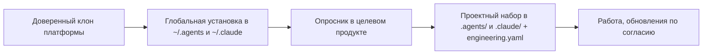

# ADE: установка и управление навыками ИИ

Как агентские среды (ADE) — Codex, Claude Code, OpenCode, Zed, Orca — находят навыки
платформы и как устроен их жизненный цикл. Порядок установки платформы и
настройки продукта описан в
[platform-installation.md](platform-installation.md); этот документ — про
расположение наборов и границы операций.

## Каталоги навыков

| Расположение | Назначение |
|---|---|
| `~/.agents/skills/` | Глобальные навыки для Codex, OpenCode, Zed и совместимых сред |
| `~/.claude/skills/` | Те же глобальные навыки для Claude Code |
| `<продукт>/.agents/skills/`, `.claude/skills/` | Проектный набор под Git; имеет приоритет над глобальными |
| `<продукт>/engineering.yaml` | Инженерный профиль: состав, источники, ревизии |

Глобальная установка — одна на машину: копирование навыков из доверенного клона
в оба каталога (порядок — [platform-installation.md](platform-installation.md)).
Обнаружение глобальных Agent Skills зависит от ADE: поддержку нужно проверить
в выбранной среде; возможно, потребуется перечитать список навыков или
перезапустить агента.

## Жизненный цикл

После настройки проекта запросы вроде «какие навыки у нас есть», «включи
тестирование», «проверь обновления» обслуживает проектный навык
`go-project-platform-manager` (описан в самом продукте:
`.agents/skills/go-project-platform-manager/SKILL.md`).

## Разрешения и границы

- Изменения глобальных каталогов — только после явного согласия; просьба
  «проверить» не разрешает установку или обновление.
- Состав набора продукта фиксирует engineering.yaml в корне;
  проектные копии имеют приоритет и не меняются от глобальных обновлений.
- Скрипты сторонних навыков не запускаются автоматически.
- Работа в worktree не требует установки: `.agents/` и `.claude/` приходят из
  Git; каждое дерево само строит генерируемые материалы (граф graphify).

## Обновления

Проверка обновлений — только чтение: сравнение ревизий engineering.yaml с источниками
(локальные клоны или `git ls-remote`). Применение — отдельная согласованная
операция: глобальное обновление затрагивает все продукты машины. Прежние снимки
сохраняются до успешной замены; при конфликте с существующим навыком установка
останавливается без перезаписи. Orca и Graphify обновляются собственными
официальными механизмами. Новые имена навыков добавляются правкой
[каталога источников навыков](../skills/go-platform-bootstrap/references/skill-sources.md),
а не непроверенным автоматическим поиском.

## Проектная установка общего UI-набора

Для общего UI-набора (`skills`/`both`) допустима установка прямо из проверенного клона на
согласованном SHA в оба проектных каталога, без глобального промежуточного шага.
Глобальные каталоги не сканируются без разрешения и не меняются. Это исключение
из обычного маршрута «глобальный источник → проект»; правила согласования состава,
сохранения ресурсов, фиксации ревизий и защиты существующих файлов сохраняются.

## ADE и назначения моделей

Выбор Codex, Claude Code, OpenCode, Orca и Zed, их адаптеры и интерактивный
опрос описаны в [единой инструкции ADE](ade-installation.md). Общий снимок
`.agents/` и `.claude/` сохраняет переносимость; нативные интеграции настраиваются
только для выбранных сред и исполнителей. Дублирующиеся skill IDs
в нативных каталогах проверяются явно. Проектный набор переносится из Git;
аутентификация и CLI — отдельные локальные зависимости.

Семь ролей, их модели/харнесы и перенастройка продукта —
[model-harness-configuration.md](model-harness-configuration.md).
