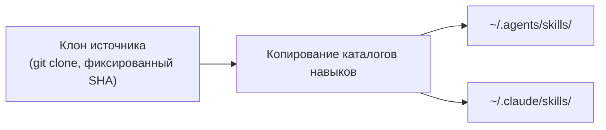

# Каталог источников навыков

Единственный источник истины о составах профилей и о том, откуда брать
навыки, агентов и референсы.
Это данные, а не код: чтобы добавить источник — дополните таблицу и
перечислите изменение в плане согласования. Ревизии (commit SHA) фиксируются
не здесь, а в engineering.yaml продукта после
каждой установки.

Установка выполняет агент: клонировать источник в общую временную папку,
скопировать нужные каталоги в `~/.agents/skills/` **и** `~/.claude/skills/`
(оба каталога всегда), не перезаписывать существующие навыки без отдельного
решения пользователя, скрипты сторонних навыков не запускать.

Копирование согласованного набора в продукт (`.agents/` и `.claude/`) и фиксация
ревизий в engineering.yaml — [SKILL.md](../SKILL.md#инициализация-репозитория-продукта); полный
жизненный цикл набора —
[skills-installation.md](../../../references/skills-installation.md).

## Источники навыков

| Источник | Репозиторий | Описание |
|---|---|---|
| addyosmani | https://github.com/addyosmani/agent-skills | Библиотека общих инженерных навыков: спеки и идеи (`spec-driven-development`, `interview-me`, `idea-refine`); процесс разработки (`test-driven-development`, `incremental-implementation`, `planning-and-task-breakdown`, `constraint-driven-development`, `source-driven-development`, `git-workflow-and-versioning`, `documentation-and-adrs`, `context-engineering`, `using-agent-skills`); качество и дизайн (`code-review-and-quality`, `code-simplification`, `debugging-and-error-recovery`, `security-and-hardening`, `doubt-driven-development`, `api-and-interface-design`); фронтенд (`frontend-ui-engineering`, `browser-testing-with-devtools`, `performance-optimization`, `accessibility-engineering`); эксплуатация (`ci-cd-and-automation`, `observability-and-instrumentation`, `deprecation-and-migration`, `shipping-and-launch`). В клоне есть и общие референсы `references/`. |
| superpowers | https://github.com/obra/superpowers | Дисциплина выполнения: `verification-before-completion` (проверка результата перед заявлением о готовности), `systematic-debugging` (систематическая отладка), `using-git-worktrees` (работа в git-worktrees). |
| samber-go | https://github.com/samber/cc-skills-golang | Идиоматичный Go: `golang-design-patterns` (паттерны проектирования), `golang-database` (работа с БД), `golang-testing` (тестирование), `golang-concurrency` (конкурентность), `golang-security` (безопасность). |
| go-architecture | https://github.com/eduardo-sl/go-agent-skills | Ревью архитектуры Go-проектов: навык `go-architecture-review`. |
| buf-protobuf | https://github.com/bufbuild/claude-plugins | Плагины Buf: навык `protobuf` — дизайн схем, buf CLI, gRPC/Connect, protovalidate, эволюция схем, разбор lint/breaking ошибок. |
| wails | https://github.com/spf13/go-skills | Навык `wails` — десктоп-приложения на Go с вебвью: v2 и v3, биндинги Go и фронтенда, сборка, отладка. |
| shadcn | https://github.com/shadcn-ui/ui | Репозиторий shadcn/ui: навык `shadcn` — установка и управление компонентами, пресеты, дизайн-системы, применение DESIGN.md. |
| vercel-react | https://github.com/vercel-labs/agent-skills | Навыки Vercel для фронтенда: `react-best-practices` (производительность React/Next.js), `composition-patterns` (паттерны композиции), `react-native-skills` (React Native и Expo), `react-view-transitions` (анимации переходов между экранами), `deploy-to-vercel` (деплой на Vercel), `vercel-cli-with-tokens` (CLI с токенами доступа), `vercel-optimize` (стоимость и производительность на Vercel), `web-design-guidelines` (аудит веб-интерфейсов), `writing-guidelines` (стиль документации). |
| microsoft-playwright | https://github.com/microsoft/playwright-cli | Официальный навык `playwright-cli` — автоматизация браузера, тестирование веб-страниц и Playwright-тестов. |
| microsoft-accessibility | https://github.com/microsoft/a11y-llm-eval | Навык `building-accessible-ui` (в репозитории — `config/skills/building-accessible-ui/`) — построение доступного UI по оценкам доступности Microsoft. |
| vercel-ai | https://github.com/vercel/ai | Репозиторий AI SDK: навык `ai-sdk` (в репозитории — `skills/ai-sdk/`) — работа с AI SDK. |
| vercel-ai-elements | https://github.com/vercel/ai-elements | Навык `ai-elements` — готовые AI-компоненты интерфейса (чат, генеративный UI). |
| swiftui | https://github.com/AvdLee/SwiftUI-Agent-Skill | Экспертный навык `swiftui-expert-skill` — разработка интерфейсов на SwiftUI. |
| swift-concurrency | https://github.com/AvdLee/Swift-Concurrency-Agent-Skill | Навык `swift-concurrency` — async/await, акторы и задачи в Swift. |
| android | https://github.com/android/skills | Официальные навыки Android: `jetpack-compose-performance` (производительность Jetpack Compose), `testing-setup` (настройка тестирования). |
| openbao | https://github.com/Getty/p5-www-openbao | Навык `openbao-general` (в репозитории — `.claude/skills/openbao-general/`) — общие вопросы работы с OpenBao (секреты). |
| supabase | https://github.com/supabase/agent-skills | Официальные навыки Supabase: `supabase` (работа с любыми продуктами Supabase: Database, Auth, Edge Functions, Storage, CLI, отладка) и `supabase-postgres-best-practices` (практики Postgres: схема, миграции, RLS, индексы, производительность). |

| impeccable | https://github.com/pbakaus/impeccable | Общий UI-навык: планирование UX, дизайн-система, создание интерфейсов, critique/audit, адаптация и полировка. Переносимые сборки по ADE, runtime и адаптеры проверять по README выбранной ревизии. |

## Локальные навыки

Установлены глобально в `~/.agents/skills/` и `~/.claude/skills/` вне
публичных источников; при настройке продукта копируются в проект напрямую.
При появлении публичного источника навык переносится в таблицу выше.

| Навык | Назначение |
|---|---|
| telegram-bot-ui | Интерфейс Telegram-ботов: тексты и микрокопирайтинг, клавиатуры и кнопки, навигация и подтверждения, состояния, стриминг AI-ответов, форматирование сообщений. |
| yandex-cloud-engineer | Инфраструктура Yandex Cloud как код: Terraform, landing zone, IAM, VPC, Managed Kubernetes, DNS, резервное копирование, GitLab CI/CD, HLD/ADR. |

## Профили и критерии

Все стартовые пути опросника используют одни критерии готовности. При подготовке
без описания продукта проверяется техническая основа выбранного стека; предметные
функции и бизнес-требования не придумываются. Для идеи или готовых требований
основа учитывает выясненные ограничения, но настройка не означает реализацию
всего продукта. Подтверждение понимания требований предшествует выбору итогового
стека; установка выполняется после согласования конкретного плана настройки.

Составы профилей правятся прямо в этом документе (таблица ниже) — это данные.

| Профиль | Состав навыков (общая основа + дополнения) |
|---|---|
| go-api | [база](../SKILL.md#проектный-набор-агентных-материалов) + golang-design-patterns, golang-database, golang-testing, golang-security, go-architecture-review, protobuf, systematic-debugging |
| web | база + golang-design-patterns, golang-database, golang-testing, protobuf, shadcn, react-best-practices, playwright-cli, systematic-debugging |
| desktop | база + golang-design-patterns, golang-testing, protobuf, wails, shadcn, playwright-cli, systematic-debugging |
| mobile-native | база + golang-testing, protobuf, swiftui-expert-skill, swift-concurrency, jetpack-compose-performance, testing-setup |
| ai | база + golang-testing, protobuf, ai-sdk, ai-elements, security-and-hardening |
| custom | база + явно согласованные навыки; технологические исключения фиксируются в docs/agent-policy.md |

База каждого профиля — graphify, go-platform-bootstrap, go-project-platform-manager,
go-product-modernization и набор навыков процесса [addyosmani/agent-skills](https://github.com/addyosmani/agent-skills),
устанавливаемый по инструкциям своего репозитория
([состав](../SKILL.md#полный-список-устанавливаемых-и-проверяемых-навыков)).
Референсы и шаблоны процесса разработки входят во все профили, включая `custom`;
custom меняет технологический состав, но сохраняет обязательный процесс и
структуру документации.

Назначение профильных дополнений и их профили:

| Навык | Назначение | В профилях |
|---|---|---|
| [golang-design-patterns](https://github.com/samber/cc-skills-golang/blob/main/skills/golang-design-patterns/SKILL.md) | идиоматичный Go, композиция, минимум лишних интерфейсов | go-api, web, desktop |
| [golang-database](https://github.com/samber/cc-skills-golang/blob/main/skills/golang-database/SKILL.md) | PostgreSQL, `pgx`, транзакции, пулы, миграции | go-api, web |
| [golang-testing](https://github.com/samber/cc-skills-golang/blob/main/skills/golang-testing/SKILL.md) | модульные, интеграционные и табличные тесты, фаззинг | go-api, web, desktop, mobile-native, ai |
| [golang-security](https://github.com/samber/cc-skills-golang/blob/main/skills/golang-security/SKILL.md) | границы доверия, инъекции, секреты, обработка ввода | go-api |
| [go-architecture-review](https://github.com/eduardo-sl/go-agent-skills/blob/main/skills/%28architecture%29/go-architecture-review/SKILL.md) | аудит границ, владения и зависимостей модулей | go-api |
| [protobuf](https://github.com/bufbuild/claude-plugins/blob/main/plugins/protobuf/skills/protobuf/SKILL.md) | `.proto`, Buf lint/generate, контракты Connect/gRPC | go-api, web, desktop, mobile-native, ai |
| [systematic-debugging](https://github.com/obra/superpowers/blob/main/skills/systematic-debugging/SKILL.md) | поиск первопричины сбоя, а не симптома | go-api, web, desktop |
| [shadcn](https://github.com/shadcn-ui/ui/blob/main/skills/shadcn/SKILL.md) | подбор и настройка UI-компонентов, дизайн-токены | web, desktop |
| [react-best-practices](https://github.com/vercel-labs/agent-skills/blob/main/skills/react-best-practices/SKILL.md) | лишние рендеры, размер бандла, задержки React | web |
| [playwright-cli](https://github.com/microsoft/playwright-cli/blob/main/skills/playwright-cli/SKILL.md) | агентное браузерное E2E, трассировки и снимки | web, desktop |
| [wails](https://github.com/spf13/go-skills/blob/main/wails/SKILL.md) | Go↔JS bindings, окна и сборка desktop (адаптировать под v3) | desktop |
| [swiftui-expert-skill](https://github.com/AvdLee/SwiftUI-Agent-Skill/blob/main/skills/swiftui-expert-skill/SKILL.md) | SwiftUI: состояние, навигация, доступность | mobile-native |
| [swift-concurrency](https://github.com/AvdLee/Swift-Concurrency-Agent-Skill/blob/main/skills/swift-concurrency/SKILL.md) | акторы, `Sendable`, структурированная конкурентность | mobile-native |
| [jetpack-compose-performance](https://github.com/android/skills/blob/main/jetpack-compose/jetpack-compose-performance/SKILL.md) | повторная композиция, списки и плавность Compose | mobile-native |
| [testing-setup](https://github.com/android/skills/blob/main/testing/testing-setup/SKILL.md) | тестовое окружение Android, эмулятор/устройство | mobile-native |
| [ai-sdk](https://github.com/vercel/ai/blob/main/skills/ai-sdk/SKILL.md) | Vercel AI SDK: tools, агентные циклы, стриминг | ai |
| [ai-elements](https://github.com/vercel/ai-elements/blob/main/skills/ai-elements/SKILL.md) | UI чата, tool calls и ввод для shadcn | ai |
| [security-and-hardening](https://github.com/addyosmani/agent-skills/blob/main/skills/security-and-hardening/SKILL.md) | усиление безопасности приложения | ai |

Общие компоненты каждого профиля и их проверки:

| Компонент | Что подготовить | Чем подтвердить |
|---|---|---|
| go | Go-модуль, feature-oriented пакеты, entrypoint, тесты | `go test ./...`, `go build ./...` из корня модуля |
| contracts | Protobuf, Buf lint и генераторы Connect, зафиксированные версии | `buf lint`, `buf generate`, сборка полученных контрактов |
| database | PostgreSQL + pgx/sqlc и миграции; для offline desktop — SQLite по HLD | Реальная проверка подключения, применение миграций в отдельной dev/test БД и integration-тест |
| environment | Версии инструментов, env example, команды запуска/остановки, изоляция worktree | Smoke-тест процесса и healthcheck; проверить отдельные порты/БД/logs каждого worktree |

Дополнения по профилям:

| Профиль | Компоненты | Что проверить |
|---|---|---|
| go-api | Общая основа, PostgreSQL | API/integration + модульные тесты |
| web | frontend, ui, e2e | Vite + React + TS; shadcn/Tailwind; production build, typecheck, браузерный smoke с вызовом API |
| ai | web + ai | AI SDK/AI Elements по месту, серверная граница ключей; тест адаптера без секрета, smoke с провайдером при наличии доступа |
| desktop | frontend, ui, e2e, desktop | Wails v3 + React, bindings, SQLite/PG по архитектуре; native build и smoke приложения на целевой ОС |
| mobile-native | mobile | Go API и выбранные SwiftUI/Compose клиенты; SDK, сборка и smoke на симуляторе/эмуляторе выбранной платформы |
| custom | Общая основа + нужные дополнительные компоненты | Адаптации и исключения записать в HLD и docs/agent-policy.md, добавить проверки в чек-лист |

Проверки инструментов — минимум; дополните graphify, sqlc, goose, mise, Swift/Xcode,
Android SDK/Gradle и другими фактически выбранными инструментами. Для pg/мобильных
проверок CLI version недостаточно: проверки компонентов должны обращаться к среде.
Зависимость «нужны credentials» нельзя заменить фиктивной зелёной проверкой.

## Референсы процесса (особый источник)

Референсы и шаблоны процесса разработки устанавливаются в `.agents/references/`
и `.claude/references/` (подкаталоги `docs/`, `templates/`, `examples/` с
сохранением имён). Источник и ревизия согласуются при настройке и фиксируются
в `engineering.yaml` продукта.

## Отдельно устанавливаемые инструменты с навыками

| Навык/инструмент | Источник | Способ установки |
|---|---|---|
| graphify | https://github.com/Graphify-Labs/graphify | `uv tool install graphifyy`; навык — по инструкции репозитория в оба глобальных каталога; затем [полная интеграция](../../../references/graphify-installation.md) в продукте |
| Orca-навыки (orca-cli, orchestration, computer-use, orca-linear, orca-emulator, orca-emulator-android, orca-per-workspace-env) | https://github.com/stablyai/orca | Собственный механизм Orca; не копировать вручную |
| app-canvas | https://gitlab16.skiftrade.kz/design/app-canvas | По [canvas-installation.md](../../../references/canvas-installation.md) из материалов платформы |

## Правила

- Имя установки обычно совпадает с каталогом навыка в клоне источника.
  Проверяйте `name` в SKILL.md; расхождения имён явно фиксируйте в плане
  и engineering.yaml (например, в vercel-labs/agent-skills каталоги без
  префикса, а `name` — с префиксом `vercel-`).
- Перечисленные составы источников — курируемые подмножества: берите только
  перечисленные навыки, даже если в клоне их больше; состав может покрывать
  весь источник (addyosmani) или быть выборкой (у samber — 5 из ~44).
- Перед копированием убедитесь, что каталог содержит `SKILL.md`.
- Пин ревизии: записывайте в engineering.yaml продукта SHA и источник; для не-Git снимка — версию или дату вместе с контрольной суммой.
- Конфликт имён: существующий навык не перезаписывается; новое имя или явное
  решение пользователя.
- Обновления глобальных копий затрагивают все продукты на машине — отдельное
  согласование; проектные копии обновляются независимо.

## Проектная установка навыков UI

Для общего UI-набора (`skills`/`both`) допустима установка прямо из проверенного клона на
согласованном SHA в оба проектных каталога, без глобального промежуточного шага.
Глобальные каталоги не сканируются без разрешения и не меняются. Это исключение
из обычного маршрута «глобальный источник → проект»; правила согласования состава,
сохранения ресурсов, фиксации ревизий и защиты существующих файлов сохраняются.

## Скиллы для целевого UI и прототипов

Общий набор поверх профиля для целевого UI и экспериментов; режим `skills`
или `both` с Canvas. Создание прототипов выбирается отдельно. Порядок установки и критерии —
[prototyping-installation.md](../../../references/prototyping-installation.md).
Источники ниже — кандидаты для выбора, не команда установить все репозитории.
Имена и ресурсы проверять по `SKILL.md` конкретной ревизии перед копированием.

| Роль | Источник | Выбор |
|---|---|---|
| UI Designer | https://github.com/nextlevelbuilder/ui-ux-pro-max-skill | `ui-ux-pro-max`; дополнительное исследование/дизайн по необходимости, с разделением ролей с Impeccable |
| UI kit | https://github.com/shadcn-ui/ui | `shadcn`; для React/shadcn, не дублировать навык профиля |
| UI Reviewer | https://github.com/jakubkrehel/skills | `better-interface` как дополнительный обзор при необходимости; основной дизайн-review — отдельный проход Impeccable; профильные better-* по необходимости, с их зависимостями |
| Web review | https://github.com/vercel-labs/agent-skills | `web-design-guidelines`; для web/webview |
| Дизайн и итерации | https://github.com/pbakaus/impeccable | `impeccable`; основа для целевого UI и прототипов, включая планирование, дизайн-систему, critique/audit и полировку |
| Apple | https://github.com/dickwu/apple-design-skill | Ревью по Apple HIG для Apple-интерфейсов; сверить имя в SKILL.md |
| Android | https://github.com/charliesbot/android-design | Дизайн Compose/Material; для Android, сверить имя в SKILL.md |
| Native mobile | https://github.com/ivan-magda/mobile-design-skills | `mobile-design-ios` и/или `mobile-design-android` по целевой ОС; не навязывать native-паттерны web |
| Motion | https://github.com/emilkowalski/skills | `emil-design-eng`, `review-animations`; остальные по задачам, избегать дублирования reviewer |
| Visual QA | https://github.com/vercel-labs/agent-browser | `agent-browser`; браузерный просмотр и проверка, CLI устанавливается отдельно; не заменяет Playwright/axe-core |
| Desktop | https://github.com/MC-Archived/Desktop-Taste-Skills | Для desktop предложить набор из `skills/` после проверки имён и зависимостей; качество окон, композиции и взаимодействий |

Для web/webview предложить основу, shadcn, web review, motion и visual QA;
для desktop добавить Desktop Taste, для macOS — Apple review по необходимости.
Для native mobile заменить web-специфичные навыки соответствующим набором iOS
или Android. При пересечении рекомендаций приоритет имеют согласованный kit,
`docs/ui/DESIGN.md` для целевого UI (либо DESIGN.md эксперимента) и правила целевой платформы. Desktop Taste заявляет поддержку Codex:
копирование переносимых файлов в Claude не доказывает работоспособность plugin-
команд; проверить ADE и явно указать неподдерживаемые возможности.
