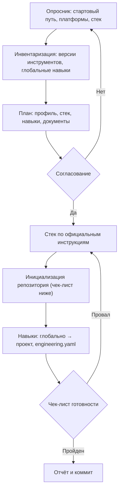
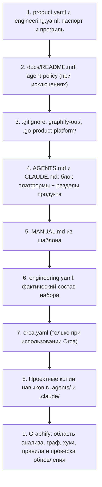

# Go Product Platform — начальная настройка

Материалы платформы — документы (md, yaml): этот навык, его references и
[каталог навыков платформы](../../references/go-product-platform/README.md); в проектах допускаются и
исполняемые скрипты. Последовательность настройки — данные в документах, а
выполняет её агент своими инструментами (файловые операции, git, shell, запуск
согласованных скриптов), подтверждая план у пользователя. Пользователь не
настраивает проект в консоли вручную. Приоритет настройки — прозрачность и
лёгкая правка последовательности и объёма действий, а не точная воспроизводимость.

## Результат

По запросу настройки доведите продукт до запускаемой основы выбранного стека:
правила разработки, документация, проектные навыки, зависимости, локальное
окружение и свежие проверки. Установка одной документации не завершает эту задачу.
Набор фиксируется в `engineering.yaml`, паспорт — в `product.yaml` (оба в корне
продукта); проектные копии в `.agents/` и `.claude/` отслеживаются в Git и имеют
приоритет над глобальными.

## Главный сценарий: один вызов → опросник → настройка

Пользователь открывает **целевой продуктовый репозиторий** и вызывает скилл:

```text
/go-platform-bootstrap
```

Достаточно одного вызова: текст задачи писать не обязательно. Это обозначение
вызова в ADE с поддержкой slash-skills; в Codex используйте нативное упоминание
`$go-platform-bootstrap` или выбор скилла. Если пользователь добавил текст
(«Подготовь этот проект к разработке», описание идеи или требования), считайте
его уже данным ответом на первый вопрос опросника.

Дальше изучите репозиторий без изменений и проведите
[опросник](references/questionnaire.md): правила диалога, стартовые пути, вопросы,
инвентаризация, итоговый план и согласование, поведение после опроса описаны
только там. После согласования плана выполните разрешённый объём по «Полной
настройке» ниже.

## Существующий продукт: рефакторинг или миграция

Для запроса модернизации существующего Git-продукта использовать
[go-product-modernization](../go-product-modernization/SKILL.md): сначала baseline,
границы и выбранный объём, затем настройка только необходимого окружения.
Не выбирать стандартный стек и не запускать scaffold поверх существующей реализации.
Аудит не требует полной установки платформы. При возврате из модернизации выполнить
только согласованные шаги настройки; не запускать опросник с начала.

## Полная настройка продукта

Фазы по порядку; подробные инструкции, составы и команды — в разделах ниже и
в указанных документах:

1. Опрос по стартовому пути, выбор профиля и согласование таблицы набора
   (навыки, агенты, референсы — с источниками и ревизиями) —
   [опросник](references/questionnaire.md); составы профилей и критерии
   компонентов —
   [skill-sources.md](references/skill-sources.md#профили-и-критерии),
   полный список навыков —
   [проектный набор](#проектный-набор-агентных-материалов).
2. Инвентаризация инструментов и глобальных навыков — только с согласия
   пользователя (вопрос 5 опросника); устанавливайте только недостающее,
   сеть и глобальные изменения включайте в план.
3. Установка стека по официальным инструкциям выбранных версий —
   [раздел ниже](#установка-по-официальным-инструкциям);
   SDD: requirements → design → plan/tasks → implement → verify → review.
4. Недостающие глобальные навыки — на согласованных ревизиях в
   `~/.agents/skills/` **и** `~/.claude/skills/`
   ([skill-sources.md](references/skill-sources.md)), затем проектный набор —
   в `.agents/` и `.claude/` продукта. Для общего набора UI разрешён
   прямой маршрут из проверенного клона в проект без глобальной установки
   по [инструкции](../../references/go-product-platform/platform/references/prototyping-installation.md).
5. Инициализация репозитория по чек-листу —
   [раздел ниже](#инициализация-репозитория-продукта):
   декларации, документация, `.gitignore`, инструкции агента, `MANUAL.md`,
   `engineering.yaml` с фактическим составом набора, проектные копии.
6. Назначения моделей по всем применимым ролям и адаптеры выбранных харнесов —
   [настройка моделей](../../references/go-product-platform/platform/references/model-harness-configuration.md) и
   [единая инструкция ADE](../../references/go-product-platform/platform/references/ade-installation.md): Codex, Claude Code,
   OpenCode, Orca, Zed. Настроить только выбранные связки ADE/исполнитель.
7. [Чек-лист готовности](#критерии-готовности) свежими
   проверками после последних изменений; провал — исправить и повторить; отдельно
   проверьте обнаружение скилла целевой ADE.
8. Итоговый отчёт: изменённые файлы, способ запуска, результаты проверок.

### Процесс настройки

Все действия выполняются в корне Git продукта; вне его меняются только
глобальные каталоги навыков после отдельного согласия. В настройку не входят
release/deploy; команды проверок фиксируются в `MANUAL.md` продукта.



### Установка по официальным инструкциям

Перед выполнением сверить выбранную версию и поддерживаемую ОС; зафиксировать
совместимые версии в mise/go.mod/package manager lock/конфигурации генераторов.
Не копировать патч-версии из старого handbook без проверки доступности.

- [Go modules](https://go.dev/doc/tutorial/create-module): `go mod init <module>`
  только при отсутствии модуля. Идентификатор брать из продукта, не из имени папки.
- [Connect Go](https://connectrpc.com/docs/go/getting-started/) и
  [Buf](https://buf.build/docs/cli/installation/): подготовить .proto и config,
  генерацию Go/Connect; версии plugins фиксировать. Домен не зависит от транспорта.
- [pgx](https://github.com/jackc/pgx), [sqlc](https://docs.sqlc.dev/en/stable/overview/install.html),
  [goose](https://github.com/pressly/goose): БД под отдельной dev-ролью, миграции и
  тестовые данные. Не использовать production URL и привилегии приложения для provisioning.
- [Vite](https://vite.dev/guide/): новый React/TS UI — `pnpm create vite <app> --template react-ts`;
  существующий использовать на месте, затем `pnpm install`, typecheck/build.
- [shadcn Vite](https://ui.shadcn.com/docs/installation/vite): Tailwind, alias,
  components.json и минимальный компонент. По запросу canvas применить утверждённый кит;
  не смешивать киты без архитектурного решения.
- [Wails v3](https://v3.wails.io/getting-started/setup/),
  [CLI](https://v3.wails.io/reference/cli/): установить совместимый wails3,
  проверить локально `wails3 init -l`, выбрать React template и пустой целевой каталог.
  Не предполагать, что шаблон называется react-ts во всех версиях.
- [Playwright](https://playwright.dev/docs/intro): установить выбранные браузеры,
  webServer/baseURL, smoke с реальным приложением и сохранением trace при ошибке.
- [AI SDK](https://ai-sdk.dev/docs/getting-started): установить в нужное TS-приложение,
  выбрать провайдера по запросу; серверный ключ только в окружении.
- Для mobile выбрать только нужную платформу, прочитать официальные SDK instructions
  и глобальные Swift/Compose навыки. Не устанавливать оба SDK без продуктовой причины.

Команды установки должны быть повторяемыми: пропускать уже существующие файлы,
не сбрасывать БД/код/пользовательскую конфигурацию. Существующий UI и приложения
подключаются на месте; не генерируйте вторую копию поверх существующего.
Секреты — через окружение, не в Git и не в чат.

### Инициализация репозитория продукта

Последовательность базовой инициализации — чек-лист; агент выполняет шаги в этом
порядке, каждый шаг идемпотентен и сохраняет пользовательский контент. Порядок
и состав правятся как текст прямо здесь. Шаги обязательны, кроме отмеченного
опциональным; исключить шаг может только пользователь в согласованном плане.



1. Декларации init: если `product.yaml` или `engineering.yaml` отсутствуют —
   создать из [шаблонов](../../references/go-product-platform/platform/templates/product.yaml)
   ([engineering.yaml](../../references/go-product-platform/platform/templates/engineering.yaml)); существующие
   не перезаписывать.
2. Документация: `docs/README.md` — карта документации; `docs/agent-policy.md`
   по контракту главы 20 — только при наличии проектных исключений. HLD при
   инициализации не создаётся — по мере проектирования по главе 20. Существующие
   документы не перезаписывать. Для целевого UI создать содержательные
   `docs/ui/DESIGN.md` и пакет фичи по [UI-контракту](../../references/go-product-platform/platform/references/prototyping-installation.md);
   не создавать фиктивную SPEC при настройке только инструментов.
3. `.gitignore`: добавить `/graphify-out/`, `/.go-product-platform/` и другие
   генерируемые артефакты продукта; существующие строки не дублировать.
4. `AGENTS.md` — единственный источник правил продукта: блок платформы и
   разделы — из [примера](references/agents-md-example.md); в существующем
   файле блок обновить, сохранив весь пользовательский текст. `CLAUDE.md` —
   тонкая ссылка на AGENTS.md с отличиями Claude Code и тем же блоком
   платформы ([пример](references/claude-md-example.md)). Оба файла полностью
   на русском.
5. `MANUAL.md`: из [шаблона](../../references/go-product-platform/platform/templates/manual.md); существующий ручной
   текст сохранить, заполнить фактические команды стека.
6. Заполнить `engineering.yaml` фактическим составом: профиль, навыки, ревизии,
   пути, агенты и референсы, ревизия платформы. Это единственное место фиксации
   состава (замена lock-файла). Заполнить ui и ai по schema 1.2, роли и
   surfaces/primary_surface, назначения и адаптеры выбранных харнесов;
   существующий профиль мигрировать без потери полей.
7. `orca.yaml`: опционально, только если выбран Orca; в `scripts.setup`
   указать команды продукта по [инструкции ADE](../../references/go-product-platform/platform/references/ade-installation.md#orca).
8. Проектные копии согласованного набора: навыки в `.agents/skills/` и `.claude/skills/`,
   агенты в `agents/`, референсы и ресурсы в `references/` обоих каталогов.
   Три навыка платформы и полный снимок материалов переносить по
   [правилам упаковки](../../references/go-product-platform/platform/references/platform-installation.md#переносимый-набор-платформы).

9. Полностью подключить Graphify по
   [инструкции](../../references/go-product-platform/platform/references/graphify-installation.md): отслеживаемая
   `.graphifyignore`, первоначальный граф, Git-хуки с сохранением Canvas,
   согласованный раздел AGENTS.md, проверка обновления и восстановление в MANUAL.md.
   Шаг обязателен для всех профилей и существующих продуктов.

### Критерии готовности

Проверки выполняет агент после завершения настройки и по каждому запросу
«проверь готовность»: свежие команды, честные результаты, никакой подмены
зелёными заглушками. Результат — отчёт в чате; для повторяемых проверок команды
должны быть зафиксированы в `MANUAL.md` (раздел «Чек-лист готовности»).

| # | Проверка | Источник истины |
|---|---|---|
| 1 | Инструменты стека установлены и версии согласованы (`go version`, `buf --version`, `node --version`, `uv tool list`, ...) | вывод команд, фиксация в MANUAL |
| 2 | Компонентные проверки из [«Профили и критерии»](references/skill-sources.md#профили-и-критерии) пройдены фактически | вывод команд |
| 3 | Каждый навык из engineering.yaml имеет `SKILL.md` в `.agents/skills/` **и** `.claude/skills/` | осмотр каталогов |
| 4 | engineering.yaml соответствует фактическому набору, включая ревизии и пути агентов/референсов | сравнение |
| 4а | Набор addyosmani/agent-skills установлен и настроен целиком по инструкциям своего репозитория: 26 навыков, slash-команды, персоны и общие чек-листы присутствуют; workflow и upstream процесса читаются; снимок платформы полон, его ссылки работают без исходного клона | состав выше и правила упаковки |
| 5 | `product.yaml`, `engineering.yaml`, `AGENTS.md`, `CLAUDE.md`, `MANUAL.md` на месте; agent-policy.md — при исключениях; AGENTS.md на русском, требует workflow и маршрутизирует каждый навык из engineering.yaml; CLAUDE.md — тонкая ссылка на AGENTS.md с блоком платформы | осмотр файлов |
| 6 | Приложение запускается: smoke-запуск и healthcheck | вывод процесса |
| 7 | Graphify настроен полностью: область анализа, код и документы в графе, query, реальные обновления, совместимость хуков Canvas, правила агента и восстановление | [приёмка Graphify](../../references/go-product-platform/platform/references/graphify-installation.md), фактические результаты в MANUAL.md |
| 8 | Все применимые ai.roles назначены; адаптеры и фактические модели проверены, ограничения записаны | [модели и харнесы](../../references/go-product-platform/platform/references/model-harness-configuration.md) |
| 9 | UI-набор работает для целевого UI и экспериментов; docs/ui и пути приложений согласованы | [UI](../../references/go-product-platform/platform/references/prototyping-installation.md) |
| 10 | Все выбранные ADE и их исполнители проверены: правила, skills, модель, запуск, интерактивный вопрос либо причина fallback; невыбранные интеграции не активированы | [ADE](../../references/go-product-platform/platform/references/ade-installation.md#приёмка-и-корректировка), MANUAL |

Отдельно проверьте обнаружение скилла целевой ADE: каталоги `.agents/skills/` и
`.claude/skills/` совместимы с Agent Skills, но версия или выбранный агент среды
могут требовать настройки или перезапуска.

Провал любой проверки — блокер: перечислите конкретные причины и недоступности,
не заявляйте готовность. Установка окружения не является выпуском продукта.

### Проектный набор агентных материалов

Состав набора согласуется в чате (таблица: навык, назначение, источник, ревизия,
пути в `.agents` и `.claude`; отдельно агенты и референсы). После согласования
агент копирует материалы в оба каталога продукта; копии и engineering.yaml
хранятся в Git и имеют приоритет над глобальными. `MANUAL.md` содержит настройку,
окружение, запуск и проверки конкретного продукта.

#### Полный список устанавливаемых и проверяемых навыков

Ссылки ведут на текущую ветку для чтения; при установке фиксируйте ревизию
(SHA; для не-Git снимка — версию или дату с контрольной суммой) в engineering.yaml продукта.
Пути внутри репозиториев — [skill-sources.md](references/skill-sources.md).

База каждого профиля — устанавливается в `.agents/skills/` и `.claude/skills/`
и проверяется чек-листом готовности:

| Навык | Назначение |
|---|---|
| go-platform-bootstrap | настройка платформы, worktrees, обновление навыков (этот навык) |
| [go-project-platform-manager](../go-project-platform-manager/SKILL.md) | проверка, выбор и обновление проектного набора |
| [go-product-modernization](../go-product-modernization/SKILL.md) | аудит существующего продукта, рефакторинг и поэтапная миграция стека |
| [graphify](https://github.com/Graphify-Labs/graphify) | граф исходников и архитектурная навигация |

Референсы и шаблоны процесса разработки — во все профили, включая `custom`;
они ставятся в `.agents/references/` и `.claude/references/`, источник и
ревизия фиксируются в `engineering.yaml` продукта.

Навыки процесса — требование: репозиторий продукта настраивается по
официальным инструкциям [addyosmani/agent-skills](https://github.com/addyosmani/agent-skills)
(README: Quick Start, «All 26 Skills», «Project Structure»; setup-гайды для
агентов — каталог `docs/` репозитория). Устанавливается и настраивается полный
состав набора: 26 навыков (25 навыков жизненного цикла и мета-навык
`using-agent-skills`) в `.agents/skills/` и `.claude/skills/`, 10 slash-команд
жизненного цикла (`/spec`, `/plan`, `/build`, `/test`, `/constraints`,
`/review`, `/webperf`, `/a11y`, `/code-simplify`, `/ship`), 5 агентных персон
(code-reviewer, test-engineer, security-auditor, web-performance-auditor,
accessibility-auditor) в `agents/`, общие чек-листы каталога `references/` —
в `references/` обоих каталогов; раскладка команд и остальных адаптеров — по
setup-гайдам репозитория для используемых в продукте ADE. Перенос — клоном на
фиксированный SHA по [правилам установки](../../references/go-product-platform/platform/references/skills-installation.md).
Всё, что инструкции репозитория требуют установить и настроить, устанавливается
и настраивается полностью; частичная установка и пропуск компонента не
допускаются — исключить компонент может только пользователь в согласованном
плане. Ревизия набора фиксируется в `engineering.yaml` продукта.

Полный каталог источников навыков — составы профилей, профильные дополнения,
критерии компонентов, репозитории, пути в клоне, способ установки — ведётся в
[skill-sources.md](references/skill-sources.md).

Правило AGENTS.md «каждый запрос» опирается на мета-навык
[using-agent-skills](https://github.com/addyosmani/agent-skills/blob/main/skills/using-agent-skills/SKILL.md)
из обязательного набора addyosmani (чтение в начале запроса и выбор применимых
навыков). Опционально по продукту:
семь [Orca skills](https://github.com/stablyai/orca) — `orca-cli` (окна, worktrees,
окружения), `orchestration` (несколько агентов и задач), `computer-use`
(desktop-интерфейсы), `orca-linear` (задачи Linear), `orca-emulator`
(iOS Simulator), `orca-emulator-android` (Android Emulator),
`orca-per-workspace-env` (изоляция окружения worktree); UI
[canvas](https://gitlab16.skiftrade.kz/design/app-canvas) (отдельная установка);
прочие навыки каталога [skill-sources.md](references/skill-sources.md) по согласованию
в чате.

## Стандарт и дополнительные компоненты

- `AGENTS.md` — полностью на русском и единственный источник правил: блок
  платформы плюс правила на каждый запрос, маршрутизация всех навыков
  из engineering.yaml, контекст продукта, конвенции, проверки и навигация
  Graphify. `CLAUDE.md` — тонкая ссылка на AGENTS.md с отличиями Claude Code
  и тем же блоком платформы; правила не дублируются. Структура и примеры —
  [agents-md-example.md](references/agents-md-example.md) и
  [claude-md-example.md](references/claude-md-example.md).
- Процесс и контракт документов — главы 19–20 handbook; проектные исключения —
  в `docs/agent-policy.md`; инварианты —
  [constitution.md](../../references/go-product-platform/platform/constitution.md). Перенос навыков и снимка материалов —
  по [правилам упаковки](../../references/go-product-platform/platform/references/platform-installation.md#переносимый-набор-платформы).
- Для UI предложите `skills`, `canvas`, `none` или явно `both`.
  Общий [UI-набор](../../references/go-product-platform/platform/references/prototyping-installation.md) применяется к
  целевому приложению и экспериментам. Отдельно выбрать единый стек прототипов
  и каталоги `prototypes/PROTOTYPE-NNNN-slug`; целевая документация — `docs/ui/`. Для canvas следуйте
  [canvas-installation.md](../../references/go-product-platform/platform/references/canvas-installation.md): агент сам
  готовит источник; canvas дополняет SPEC, не заменяя инженерную документацию.
- Для каждого вида работы выбрать модель/провайдера/харнес по
  [матрице ролей](../../references/go-product-platform/platform/references/model-harness-configuration.md). OpenCode читает
  AGENTS.md и `.agents/skills/`; нативные адаптеры устанавливаются отдельно.
- Повторные запросы управления набором и моделями (проверка, выбор, обновление) —
  [go-project-platform-manager](../go-project-platform-manager/SKILL.md).
  Worktree получает `.agents/` и `.claude/` из Git; каждое дерево строит
  генерируемые материалы (граф graphify) само.

## Проверки и обновления

Запрос «только проверить» — осмотр набора и окружения и отчёт; setup не
запускайте. Обновления навыков — только по отдельному согласию: сравнение
ревизий с engineering.yaml, влияние на другие продукты машины, прежние снимки
до успешной замены, проектные копии обновляются отдельно; Orca и Graphify —
их собственными механизмами. Подробный порядок —
[go-project-platform-manager](../go-project-platform-manager/SKILL.md).
