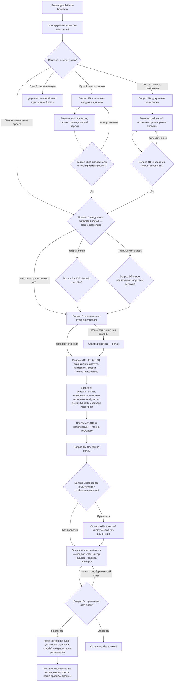

# Опросник настройки в чате

Вход: `/go-platform-bootstrap` в целевом Git-репозитории; текст задачи не
обязателен. Без текста агент начинает с вопроса 1; текст в запросе считается
уже данным ответом на него («Подготовь этот проект к разработке» выбирает путь
А, идея или требования — пути Б и В, модернизация — путь Г). В ADE с другой формой вызова меняется
только упоминание скилла. Пользователь не запускает команды, не заполняет
конфиги и не выбирает технические имена профилей: агент ведёт диалог и сам
устанавливает согласованный набор.

## Формат вопросов

Каждый вопрос ниже записан в том виде, в котором его видит пользователь:

- **Формулировка** — точный текст вопроса.
- **Варианты (один)** — нативная форма с одним выбором и свободным ответом.
- **Варианты (можно несколько)** — нативные чекбоксы/multi-select, если поддержаны;
  иначе последовательные вопросы с опциями. Markdown ниже описывает содержание,
  его не нужно дословно печатать вместо вызова инструмента.
- Свободный ответ обязателен. Если tool уже предоставляет поле Other/свой текст,
  отдельный пункт «Свой вариант» из списка ниже не добавлять; иначе оставить его.
  В части вопросов свободный текст встроен в вариант
  (например, «Да: __________»). Вопросы без вариантов помечены как
  «свободный ответ».
- **→ Агенту:** — условная логика и действия после ответа; пользователю не
  показываются.

Перед первым вопросом примените [правила интерактивного выбора](../../../references/go-product-platform/platform/references/ade-installation.md#интерактивный-выбор-пользователя).
Проверяйте tools текущей сессии, а не ADE, которую пользователь хочет настроить.
При лимите опций разбивайте вопрос на шаги, сохраняя весь выбор. Не вызывайте
недоступный инструмент и не переключайте режим ADE ради опроса. В чат переходите
только при недоступности/ограничениях инструмента или по предпочтению пользователя.
Для согласования действий используйте только разрешённый для этого канал.
Молчание, предвыбор, таймаут и пустой результат не означают выбора или одобрения.

## Правила диалога

- Один вопрос за раз. Ждите ответа перед зависимым выбором.
- Сначала прочитайте README, `docs/agent-policy.md`, `product.yaml` и
  `engineering.yaml`, если они есть. Не меняйте файлы и не обращайтесь к сети.
- Явно заданные ответы учитывайте; найденное в коде предлагайте как
  рекомендацию с подтверждением. Не отправляйте пользователя разбираться в
  стеке или CLI.
- После ответа переходите к следующему применимому вопросу, неприменимые
  пропускайте. Не повторяйте уже разрешённое действие и не включайте обновление
  всех глобальных skills в первоначальную настройку.
- Если пользователь отменяет до применения, остановитесь без записей. При
  отказе в глобальном осмотре не заявляйте наличие/отсутствие skills:
  предложите настройку только материалов проекта и объясните, что полная
  готовность останется непроверенной.

## Сценарий опроса

Основной маршрут:

Схема показывает основной маршрут: условные шаги 2а, 2б и 3а–3в задаются
только когда ответ ещё не известен; «есть уточнения» возвращает к предыдущему
вопросу, «изменить выбор» — к вопросу 6 с уточнением затронутых пунктов.

### Вопрос 1. С чего начать

**Формулировка:** «С чего вы хотите начать?»

**Варианты (один):**

1. **Подготовить проект к разработке** — выбрать стек и окружение, установить
   всё необходимое для начала разработки; описание продукта можно добавить
   позже.
2. **Описать идею нового продукта** — рассказать о продукте несколькими
   предложениями, уточнить первую версию и настроить проект под неё.
3. **Разобрать готовые требования** — прикрепить документы или дать ссылки;
   сначала согласуем понимание требований, затем настроим проект.
4. **Модернизировать существующий продукт** — аудит, рефакторинг или миграция
   приложения из Git на другой стек.
5. Свой вариант: __________

**→ Агенту:** не выбирайте путь по умолчанию. Если намерение уже явно указано
в запросе, назовите выбранный путь и продолжайте без повторного вопроса.
Наличие README или кода само по себе не определяет путь. Сохраняйте
существующий код, пользовательские файлы и стек во всех четырёх путях: подготовка
проекта не означает очистку репозитория.

#### Путь Г — модернизировать существующий продукт

Перейти в [go-product-modernization](../../go-product-modernization/SKILL.md).
Использовать уже переданные Git URL/путь, целевой стек и объём; уточнить только
неизвестное. При голом выборе предложить аудит, подготовку плана или реализацию
выбранных этапов. Начать с обследования и baseline, не с генерации нового приложения.
К вопросам стека/ADE и итогового плана bootstrap возвращаться только для
необходимой настройки, сохранив ответы. «Только аудит» заканчивается отчётом.

#### Путь А — подготовить проект к разработке

Переходите к вопросу 2. Не требуйте описания пользователей, бизнес-функций или
границ MVP. По выбранному стеку подготовьте инструменты, зависимости,
структуру, правила, навыки и минимальную запускаемую основу с реальными
проверками; не ограничивайтесь документацией. Не придумывайте предметную
область и функциональность: SPEC настройки описывает только техническую основу.

#### Путь Б — описать идею нового продукта

**Вопрос 1Б (свободный ответ):** «Что делает продукт и для кого? Достаточно
нескольких предложений».

**→ Агенту:** используйте уже данное описание; уточняйте по одному вопросу
только то, что влияет на первую версию и настройку. Покажите краткое резюме —
пользователи, основная задача, границы первой версии — и подтвердите его
вопросом 1Б-2.

**Вопрос 1Б-2. Подтверждение резюме:** «Продолжаем с такой формулировкой?»

**Варианты (один):**

1. Да, верно — продолжаем.
2. Есть уточнения: __________

#### Путь В — разобрать готовые требования

**Вопрос 1В (свободный ответ, если материалы ещё не даны):** «Прикрепите
документы или дайте ссылки на требования». Вложения передавайте через обычный
чат, а не инструмент с текстовым полем ответа.

**→ Агенту:** прочитайте все материалы доступными средствами; ссылки открывайте
для чтения. Если источник недоступен, назовите его и попросите доступную копию
или выдержку, не подменяйте его предположениями. Покажите короткое резюме:
назначение и пользователи продукта, функциональные и нефункциональные
требования, ограничения и границы первой версии. Для выводов указывайте
исходный документ/раздел или ссылку; отдельно обозначьте предположения,
противоречия и пробелы. Не повторяйте вопросы, на которые материалы уже
отвечают; существенные неизвестные уточняйте по одному вопросу, при конфликте
источников выясните, какой актуален.

**Вопрос 1В-2. Подтверждение понимания:** «Верно ли я понял требования?»

**Варианты (один):**

1. Да, верно — продолжаем.
2. Есть уточнения: __________

**→ Агенту:** дождитесь ответа, внесите исправления и только затем продолжайте
общий опрос. Подтверждение понимания требований не является разрешением
установки. После согласования плана сохраните результат анализа в документах
продукта под `docs/` по главам 19–20: требования, источники и принятые
уточнения. Полные исходные вложения не добавляйте в Git автоматически.
Настройка готовит основу разработки, а не реализует все функции из требований.

**Все пути.** Дальше идут вопросы 2–6 и общая настройка с
[чек-листом готовности](../SKILL.md#критерии-готовности). Пропускайте вопросы,
ответы на которые уже известны из запроса или требований.

### Вопрос 2. Целевые приложения

**Формулировка:** «Где должен работать продукт?»

**Варианты (можно несколько):**

- [ ] Браузер (web)
- [ ] Настольное приложение (desktop)
- [ ] Мобильное приложение (mobile)
- [ ] Только сервер/API
- [ ] Несколько платформ
- [ ] Свой вариант: __________

**Вопрос 2а (если выбран mobile и ответ ещё не известен).** «Какие мобильные
платформы?»

**Варианты (один):**

1. iOS
2. Android
3. Обе

**Вопрос 2б (если выбрано «Несколько платформ»).** «Какое приложение запускаем
первым?» Перечисляйте только выбранные платформы.

**Варианты (один):**

1. Браузер
2. Настольное приложение
3. Мобильное приложение
4. Только сервер/API
5. Свой вариант: __________

Остальные платформы укажите отдельными этапами плана; не называйте весь набор
готовым после проверки одного клиента.

**→ Агенту:** соответствие ответов профилям: браузер → web, desktop → desktop,
mobile → mobile-native, сервер → go-api. Если ответ требует комбинации,
используйте ближайший базовый профиль с дополнительными skills/components
([составы профилей](skill-sources.md#профили-и-критерии)); не теряйте выбранные
пользователем цели. Внутреннее имя профиля пользователь знать не обязан.

### Вопрос 3. Стек и локальное окружение

Покажите предложение по ответам и handbook:

> «Предлагаю Go и PostgreSQL для сервера, React для браузера, API через
> Protobuf/Connect. Подходит стандарт платформы или есть ограничения?»

Для desktop — Wails, для mobile — выбранный SwiftUI/Compose; перечисляйте
только нужные части.

**Варианты (один):**

1. Подходит стандарт платформы.
2. Есть ограничения или замены: __________

**→ Агенту:** в существующем продукте рекомендация — дополнить найденный стек,
а не заменить его. ОС и уже видимые версии определите сами. Уточните только
неизвестное, влияющее на установку.

**Вопрос 3а (если есть БД и ответ ещё не известен).** «Где будет dev-база
данных?»

**Варианты (один):**

1. Локальная на моей машине.
2. Удалённая — доступ уже есть.
3. Не знаю — предложи вариант.
4. Свой вариант: __________

**Вопрос 3б (если ответ ещё не известен).** «Есть ли ограничения на доступ или
установку инструментов?»

**Варианты (один):**

1. Нет.
2. Да: __________ — опишите ограничение

**Вопрос 3в (если применимо, свободный ответ).** «Под какие платформы нужно
собирать?» Спросите только если платформы сборки влияют на установку.

**→ Агенту:** запишите адаптации в план. Не спрашивайте пароли и токены в чате.

### Вопрос 4. Опциональные возможности

**Формулировка:** «Какие дополнительные возможности подключить?»

**Варианты (можно несколько):**

- [ ] AI-функции
- [ ] Инструменты UI — выбрать режим ниже
- [ ] Ничего из перечисленного
- [ ] Свой вариант: __________

**Для продукта с UI выбрать один режим:**

1. Общий набор UI-навыков — целевой интерфейс и эксперименты, дизайн-система в `docs/ui/` (`skills`).
2. Canvas — визуальная среда дизайна app-canvas.
3. Без дополнительных инструментов UI.
4. Оба — общий набор навыков и Canvas, с единой целевой дизайн-системой (`both`).

Для разработки UI следовать [инструкции](../../../references/go-product-platform/platform/references/prototyping-installation.md):
проектная установка без обязательной глобальной; состав зависит от платформы.
Отдельно выбрать: нужны ли экспериментальные прототипы, их единый стек и
размещение отдельных каталогов `PROTOTYPE-NNNN-slug` внутри `prototypes/`.
Это отдельный выбор от UI-режима. Указать в плане: только навыки, целевой UI/docs/ui
или конкретные эксперименты; не превращать прототип автоматически в продукт.

**→ Агенту:** выясняйте AI-функции и провайдера только при необходимости.
При выборе AI для web используйте профиль ai; для другого клиента добавьте
нужные AI skills/components. Ответ «нет» на canvas не блокирует обычную
настройку UI. При согласии локальный клон canvas проверяет/готовит агент;
спрашивайте пользователя только о недоступном доступе. Не требуйте от
пользователя вручную клонировать репозиторий или выполнять установку.

### Вопрос 4а. Среды разработки

Задаётся для всех продуктов; уже указанные предпочтения не спрашивать повторно.

**Формулировка:** «В каких средах вы хотите работать над проектом? Можно несколько».

**Варианты (можно несколько):**

- [ ] Codex
- [ ] Claude Code
- [ ] OpenCode
- [ ] Orca
- [ ] Zed
- [ ] Свой вариант: __________

**→ Агенту:** не устанавливать все ADE. При отсутствии multi-select задать для
каждой ещё не выбранной среды вопрос «Подключить …?» с Да/Нет. Если пользователь
сразу назвал весь набор, принять его и пропустить остальные вопросы выбора.
При нескольких ADE спросить основную; при одной — записать её без нового вопроса.
Для Orca уточнить агента, для Zed — встроенный агент, внешний ACP или терминал,
затем исполнителя. Использовать [ade-installation.md](../../../references/go-product-platform/platform/references/ade-installation.md).
Объяснить варианты простым языком, не требовать от пользователя знания ACP/CLI.

### Вопрос 4б. Модели по ролям

Задаётся для всех продуктов, независимо от выбора AI-функций.

**Формулировка:** «Как распределить модели и среды выполнения между задачами?»

1. Одна выбранная модель/харнес для всех применимых ролей.
2. Разные назначения по ролям.
3. Сохранить текущие назначения, заполнить только отсутствующие.
4. Свой вариант: __________

**→ Агенту:** показать семь ролей: документация, код, UI, ревью кода, ревью
дизайна, требования, архитектура. Для каждой получить ADE, харнес, провайдера и
точный model ID (при необходимости variant), используя
[контракт назначений](../../../references/go-product-platform/platform/references/model-harness-configuration.md).
Использовать только выбранные в 4а среды и исполнителей;
Claude/DeepSeek/GLM — семейства моделей, не взаимозаменяемые названия харнесов.
Если точный ID пока неизвестен, проверить каталог на этапе инвентаризации и
показать конкретное назначение до применения. Для отсутствующего UI отметить
ui/design_review как неприменимые в MANUAL. Не выдумывать доступные модели.
Ревью — отдельный контекст даже при одной модели. Существующие ответы сохранять.

### Вопрос 5. Инвентаризация

**Формулировка:** «Можно проверить установленные инструменты и глобальные
навыки, чтобы использовать существующие и установить только недостающие?»

**Варианты (один):**

1. Проверить — осмотр без изменений.
2. Без проверки глобальных навыков.
3. Свой вариант: __________

**→ Агенту:** это проверка без изменений. Если уже разрешено — не спрашивайте
снова. После согласия осмотрите `~/.agents/skills/` и `~/.claude/skills/` и
выполните локальные проверки версий (`go version`, `node --version`,
`uv tool list` и т.п.). Проверить выбранные харнесы, доступность моделей
и нативные адаптеры по [инструкции ADE](../../../references/go-product-platform/platform/references/ade-installation.md).
Список новых навыков формируйте по выбранному набору,
Graphify включайте всегда; для Orca предложите нужные официальные Orca skills.
При отказе в глобальном осмотре действуйте по правилам диалога выше.

### Вопрос 6. Итоговый план

До запроса применения самостоятельно подготовьте конкретный план: выбранные
совместимые версии и источники, известные отсутствующие инструменты/skills,
планируемые файлы/генераторы и команды проверок. Если версии нужно проверить
по сети, согласуйте такой просмотр в рамках диагностики.

Покажите короткое человеческое описание:

- Продукт и целевые приложения.
- Выбранный стартовый путь; для готовых требований — согласованное понимание и
  оставшиеся открытые вопросы, для технической подготовки — границы основы без
  придуманной функциональности продукта.
- Стек, локальная среда и способ запуска; целевой UI/docs/ui и отдельный стек экспериментов.
- Выбранные ADE и основная среда; таблица семи ролей → ADE → исполнитель →
  провайдер → точная модель → адаптер/запуск, проверки и непроверенные назначения
  по [инструкции ADE](../../../references/go-product-platform/platform/references/ade-installation.md).
- Стандартный процесс требований, дизайна, реализации, проверки и ревью.
- Документы и конфигурация, которые появятся/будут дополнены в Git.
- Структурированная таблица проектных навыков: имя, назначение, репозиторий,
  ревизия, пути в `.agents/skills` и `.claude/skills`; отдельные списки
  агентов и референсов. Явно согласовать этот список перед установкой.
- Точные глобальные инструменты/источники для установки; уже установленные
  будут использованы. Обновления существующих навыков — отдельное решение.
- Опциональные компоненты и проверки готовности; известные ограничения.

**Вопрос 6а. Применение:** «Применить этот план настройки?»

**Варианты (один):**

1. Настроить.
2. Изменить выбор.
3. Отменить.
4. Свой ответ: __________

**→ Агенту:** ответ разрешает только показанный объём. Если пользователь
заранее одобрил именно этот конкретный объём, достаточно показать итог и
продолжить. «Изменить выбор» и любой другой ответ, кроме «Настроить», установку
не разрешают: уточните, что изменить, и вернитесь к затронутому вопросу.

## После опроса

Агент сам выполняет согласованный план: устанавливает стек по официальным
инструкциям, ставит недостающие навыки и копирует набор в `.agents/` и
`.claude/`, проводит
[инициализацию репозитория](../SKILL.md#инициализация-репозитория-продукта)
и завершает [чек-листом готовности](../SKILL.md#критерии-готовности).
Пользователю показывает ход работы и итог: что готово, как запускать продукт,
какие проверки прошли. При блокере продолжает независимую работу, задаёт
только необходимый вопрос и не объявляет окружение полностью готовым.

Возобновление: читайте предыдущие ответы в чате и инженерный профиль
`engineering.yaml` продукта, спрашивайте только изменившиеся/незаполненные
параметры. Не запускайте опрос заново для простого запроса проверки или
обновления навыков.

Результат настройки включает отслеживаемые `.agents/`, `.claude/`, `MANUAL.md`,
`AGENTS.md`, `CLAUDE.md` и декларации `product.yaml` с `engineering.yaml` в
корне. В инструкциях на русском обязательны процесс разработки и приоритет
проектных навыков; AGENTS.md/CLAUDE.md дополняют правилами на каждый запрос,
маршрутизацией задач по навыкам, контекстом продукта, конвенциями и командами
проверки (см. [SKILL.md](../SKILL.md) и примеры итоговых файлов
[agents-md-example.md](agents-md-example.md),
[claude-md-example.md](claude-md-example.md)).
