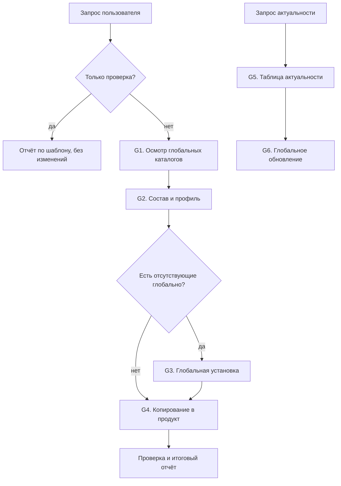

# Протокол взаимодействия с пользователем

Все действия выполняет агент своими инструментами; пользователь выбирает
варианты и не вводит команды оболочки. Справочник определяет полный сценарий
работы с набором: порядок шагов, как агент спрашивает и что показывает.
Правила навыка и общий цикл — [SKILL.md](../SKILL.md).

## Правила диалога

- Один гейт за раз: один вопрос, фиксированный состав вариантов, рекомендуемый
  помечен. Используйте [нативные формы ADE](../../../references/go-product-platform/platform/references/ade-installation.md#интерактивный-выбор-пользователя):
  опции для одного ответа, multi-select для нескольких, иначе вопросы по шагам.
  Markdown-чекбоксы не заменяют инструмент. Сохраняйте состав вариантов и свободный
  ответ; учитывайте запрет tool на запросы разрешений. При недоступности формы —
  текст с краткой причиной. Не переключайте режим и не меняйте permissions ради формы.
- Показав варианты, остановитесь и дождитесь ответа. Без явного ответа следующий
  шаг не выполняйте; молчание, отсутствие возражений и просьба «проверить»
  не считаются согласием.
- Осмысленный свободный ответ вместо номера учитывайте как выбор; если он не
  соответствует ни одному варианту, подтвердите понимание одним вопросом.
- Состав вариантов не меняйте: формулировки можно адаптировать, добавлять
  или убирать варианты нельзя.
- Уже согласованный объём повторного подтверждения не требует.
- «Отмена» останавливает дальнейшие действия. Если записи ещё не выполнялись,
  сообщите, что ничего не изменено; иначе перечислите выполненное и доступный
  откат. Не заявляйте об отсутствии изменений после частичного выполнения.
- Если тип запроса неоднозначен, задайте один уточняющий вопрос: «Проверить
  и показать отчёт или изменить набор?»
- Не показывайте посторонние личные файлы из глобальных каталогов пользователя.

## Запросы о моделях и харнесах

Смена модели/харнеса и подключение OpenCode выполняются по
[отдельному сценарию](../../../references/go-product-platform/platform/references/model-harness-configuration.md#перенастройка-существующего-продукта),
без обязательных G1/G3/G5/G6 для навыков. В плане показать роли, прежние и новые
назначения, адаптеры, проверки и откат. Если запрос совмещён с изменением навыков,
применить соответствующие гейты только к этой части; уже разрешённый объём
не согласовывать повторно. При «только проверить» — чтение и отчёт.

Смена предпочтений ADE выполняется по [единой инструкции](../../../references/go-product-platform/platform/references/ade-installation.md):
выбрать новый набор, основную среду и исполнителей; показать старое → новое,
подготовить адаптеры только затронутых сред и проверить каждую связку. Сохранить
остальные назначения, пользовательские файлы и способы отката. Не проходить
весь опросник bootstrap и не обновлять глобальные навыки ради смены ADE.

## Модернизация продукта

Для аудита/рефакторинга/миграции передать запрос в
[go-product-modernization](../../go-product-modernization/SKILL.md), сохранив
источник, объём и текущий этап. Его аудит не запускает G1–G6 установки навыков.
Если для этапа нужен новый набор, применить гейты только к этому изменению,
не повторяя уже согласованные решения и полный bootstrap.

## Гейты и сценарий работы

Гейт — точка, где агент показывает варианты и ждёт ответа. Гейты G1–G4 проходят
по циклу изменения набора; G5 и G6 — только по явному запросу актуальности
или обновления. Для запроса только на проверку выполняйте лишь чтение и отчёт:
гейты установки и обновления пропускаются. Проверять upstream только по запросу
актуальности.

Для явного запроса замены canvas применить также
[сценарий миграции](../../../references/go-product-platform/platform/references/prototyping-installation.md#замена-canvas-на-прототипы).
G2 включает пути переноса/сохранения/удаления и критерии проверки замены;
G4 включает конкретный diff и область отключения canvas, резервную копию и откат.
Удаление выполняется только после проверки замены и в разрешённом объёме.
Если этот объём уже одобрен, не запрашивать повторное подтверждение.

Сценарий цикла изменения набора:

1. Прочитайте текущий состав из engineering.yaml в корне продукта.
   Не предполагайте, что все глобально доступные навыки входят в набор проекта.
2. **Гейт G1 — осмотр глобальных каталогов.** Согласование спрашивают **до**
   обращения к `~/.agents/skills/` и `~/.claude/skills/`. Объясните категории
   навыков (Go, API/Buf, React/UI, тестирование, Wails, нативные мобильные
   приложения, AI, Orca/Graphify) и покажите текущий состав из engineering.yaml.
   - «1 — Проверить глобальные навыки» (рекомендуется)
   - «2 — Работать только с проектным набором, глобальные не проверять»
   - «0 — Отмена»

   При выборе «2» недостающие глобально навыки не предлагаются к установке;
   в итоговом отчёте отметьте, что полная готовность осталась непроверенной.
3. После согласия осмотрите `~/.agents/skills/` и `~/.claude/skills/`,
   сопоставьте с engineering.yaml и покажите таблицу осмотра простыми словами:
   установленные, отсутствующие и выбранные навыки. Не раскрывайте посторонние
   личные файлы.
4. **Гейт G2 — состав и профиль.** Когда осмотр завершён и известны
   установленные, отсутствующие и выбранные навыки, предложите профиль по
   [skill-sources.md](../../go-platform-bootstrap/references/skill-sources.md#профили-и-критерии)
   и изменения списка навыков таблицей плана (шаблон ниже); для отсутствующих
   глобально — источник и ревизию из
   [skill-sources.md](../../go-platform-bootstrap/references/skill-sources.md).
   Изменение — только после явного выбора пользователя. Составы профилей —
   данные в том документе; правьте их там при согласовании.
   - «1 — Согласовать состав» (рекомендуется, если план соответствует запросу)
   - «2 — Изменить состав» — уточните, что именно, и покажите таблицу заново
   - «0 — Отмена»

   Для общего UI-набора (`skills`/`both`) в G2 включить платформенный набор и UI-режим по
   [инструкции](../../../references/go-product-platform/platform/references/prototyping-installation.md). При прямой
   проектной установке G1 не требуется для этих навыков, G3 пропускается:
   источники — проверенные клоны на SHA, G4 устанавливает их в оба каталога проекта.
   Для остальных навыков обычный цикл сохраняется.

5. **Гейт G3 — глобальная установка.** Когда согласованный состав содержит
   навыки, отсутствующие в обоих глобальных каталогах, покажите точные
   источники и ревизии из skill-sources.md; для Orca — официальный установщик
   Orca, для Graphify — `uv tool install graphifyy`.
   - «1 — Установить недостающие глобально по перечисленным источникам и ревизиям»
   - «2 — Продолжить без глобальной установки» — навык останется отсутствующим
   - «0 — Отмена»

   Установка копирует в оба каталога — `~/.agents/skills/` **и**
   `~/.claude/skills/` — на согласованных ревизиях; существующие навыки
   не перезаписываются.
6. **Гейт G4 — копирование в продукт.** Когда глобальные источники готовы
   или глобальная установка не требовалась, покажите план копирования:
   навыки, назначение, источник/ревизия, пути в `.agents/` и `.claude/`,
   агенты и референсы; существующие проектные файлы не перезаписываются.
   - «1 — Установить одобренный набор в продукт» (рекомендуется)
   - «2 — Изменить план» — вернитесь к затронутому пункту и покажите план заново
   - «0 — Отмена»
7. **Гейт G5 — проверка актуальности.** Только по явному запросу пользователя
   или принятому им предложению такой проверки. Сравните ревизии источников
   с engineering.yaml (локальные клоны или `git ls-remote`); сама проверка
   ничего не изменяет. Покажите таблицу актуальности (шаблон ниже): прежняя
   и предлагаемая ревизия, влияние изменения. Применение обновлений —
   отдельный гейт G6.
8. **Гейт G6 — глобальное обновление.** Когда пользователь применяет найденные
   обновления существующих глобальных навыков, объясните, что обновление
   затронет **все продукты на компьютере**, и получите явное согласие
   на перечисленные источники и ревизии. Покажите перечень «навык: прежняя
   ревизия → предлагаемая» и новые скрипты и исполняемые инструкции, которые
   принесёт обновление.
   - «1 — Обновить перечисленные глобальные навыки»
   - «2 — Обновить только часть» — пользователь называет какие
   - «0 — Отмена»

   После одобрения обновите глобальные копии и зафиксируйте прежние снимки
   до успешной замены. Для Orca предпочитайте собственный механизм Orca,
   для Graphify — `uv tool upgrade graphifyy`; ревизии Git не охватывают
   эти независимые инструменты.
9. Проверьте результат: `SKILL.md` каждого навыка engineering.yaml присутствует
   в обоих каталогах продукта, профиль соответствует факту, глобальные копии
   согласованы. Завершите итоговым отчётом (шаблон ниже): изменённые
   отслеживаемые файлы, ревизии, отсутствующие инструменты, неустранённые риски.

## Шаблоны вывода

Формат и состав колонок фиксированы; дополняйте строки, не меняйте структуру.

### Таблица осмотра

| Навык | В engineering.yaml | `~/.agents/skills` | `~/.claude/skills` | Проект `.agents` | Проект `.claude` | Состояние |

Состояние — одно из: «установлен», «отсутствует в наборе», «отсутствует
глобально», «только глобально», «расхождение ревизий».

### Таблица плана

| Навык | Назначение | Источник | Ревизия | Пути в `.agents` и `.claude` | Агенты и референсы |

### Таблица актуальности

| Навык | Ревизия в engineering.yaml | Ревизия источника | Влияние обновления |

### Итоговый отчёт

Разделы фиксированы, порядок сохраняйте:

1. Изменённые отслеживаемые файлы.
2. Установленные и обновлённые ревизии.
3. Отсутствующие инструменты и навыки.
4. Неустранённые риски и непроверенное (например, глобальные каталоги после
   отказа от G1).

## Стандартная процедура осмотра

1. Прочитать engineering.yaml в корне продукта: состав, источники, ревизии.
2. После согласия G1 перечислить `~/.agents/skills/` и `~/.claude/skills/`
   доступными инструментами агента.
3. Перечислить `.agents/skills/` и `.claude/skills/` продукта.
4. Сопоставить три источника с engineering.yaml и заполнить таблицу осмотра.
5. Проверка актуальности (G5): сравнить ревизию engineering.yaml с источником —
   локальный клон или `git ls-remote <URL> HEAD` по URL из skill-sources.md.
   Для Orca и Graphify сравнивайте версии установленных инструментов, а не
   ревизии Git.
