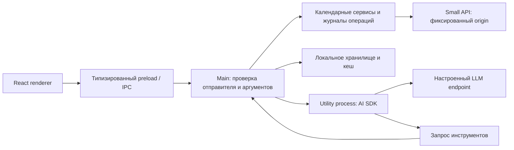

# Аудит архитектуры Small Desktop Calendar

Дата: 30 октября 2026 года. Основа: HEAD `ae558e2` **и текущее рабочее дерево**, включая незакоммиченные изменения восстановления авторизации. Аудит и план сохранены отдельно от незавершённых `tasks/plan.md` и `tasks/todo.md` по указанию пользователя. Изменения поведения не вносились.

## Вывод

Основа архитектуры пригодна для дальнейшего развития: локальный renderer изолирован, привилегии сосредоточены в main, модель работает через utility process, календарные операции ограничены проверяемыми контрактами. Переписывание приложения сейчас не обосновано. Приоритеты: сохранить корректный результат записи при сбое кеша, проверить приватность вложений, определить допустимый риск хранения пароля и подготовить защищённую воспроизводимую сборку.

Подтверждённого удалённого RCE или обхода авторизации не обнаружено. Это ограниченный аудит desktop-репозитория, а не заключение о безопасности серверов Small. Ни production API, ни реальные встречи не изменялись.

## Архитектура и границы доверия

Защищаемые данные: пароль Small, cookies, ключ LLM, сведения о встречах, участники, вложения. Недоверенные источники: renderer, ответы Small, ответы модели, текст событий и локальные файлы. Utility process разделяет выполнение, но не является полноценной OS-песочницей для Node-кода.

Положительные свойства, которые нужно сохранить:

- `sandbox`, `contextIsolation`, отключённые Node/webview, запрет навигации и новых окон; CSP запрещает внешние соединения renderer.
- IPC проверяет главный frame и точный URL; секреты не возвращаются renderer.
- Small transport фиксирует origin и допустимые операции; redirects запрещены. LLM transport также запрещает redirects и уход с выбранного endpoint.
- Проверяются аргументы инструментов; модель подготавливает действия, запись проходит отдельные прикладные сценарии. Есть журналы неопределённых результатов и защита повторов.
- Кеш имеет ограничения размера/количества, привязку аккаунта и поколения инвалидации. Ответ календаря ограничен 8 MiB.
- Секреты записываются атомарно, с приватными правами, AES-GCM и привязкой назначения через AAD.

## Находки

### A01 — P1: ошибка кеша подменяет результат календарной записи

**Подтверждённый дефект.** `src/main/calendar-ipc.ts:29–42`, `src/main/series-invalidation.ts:16–22`, обёртка `writer.create` в `src/main/index.ts` ожидают инвалидацию внутри `finally`. `EventCache.invalidateEvents/clearAll` могут выбросить файловую ошибку. Тогда успешный ответ сервера или исходная ошибка с `unknownOutcome` заменяются ошибкой кеша. Пользователь получает неправильный статус и может повторить действие. Журнал снижает риск дубля, но не исправляет статус.

Проверено синтетическим вызовом настоящего `invalidatingSeries`: операция выполнилась один раз и вернула успех, затем invalidate выбросил EACCES; вызывающий получил именно ошибку кеша.

**Исправление:** сохранять первичный результат операции, отдельно помечать кеш недействительным и сообщать о деградации синхронизации. Нельзя просто игнорировать сбой удаления: дисковый кеш должен оставаться непригодным для чтения до успешной очистки/перезагрузки. Тесты: success + EACCES, unknown outcome + EACCES, отказ + EACCES, восстановление после перезапуска.

### A02 — P1 до проверки контракта: все вложения запрашиваются как public

**Подтверждён запрос, не подтверждена фактическая публичная доступность.** `src/main/meeting-attachments.ts:46` всегда отправляет `is_public=true`; `src/main/attachment-request.ts:8` принимает только это значение. Клиент не выражает намерение «доступ только участникам». Значение флага и доступ к скачиванию нужно проверить на backend, не выводить из имени поля.

**Исправление:** тестовым несекретным файлом в согласованной тестовой среде проверить доступ владельца, участника, другого аккаунта и анонимного клиента. Зафиксировать контракт; использовать приватную загрузку либо серверную авторизацию скачивания. Если backend предоставляет только публичные файлы, до его исправления отключить соответствующий сценарий для конфиденциальных вложений.

Дополнительный риск: файлы загружаются сразу при выборе и последовательно. При отмене черновика или ошибке второго файла первый уже существует на сервере, а клиентского удаления/TTL в этом сервисе нет. Проверить серверную очистку непривязанных вложений; затем добавить staging/finalize либо TTL и безопасное удаление по подтверждённому контракту.

### A03 — P1 для корпоративного распространения: ключ расшифровки рядом с паролем

**Известное архитектурное ограничение, а не взлом AES.** `src/main/local-secrets.ts:74–83` хранит `master.key` в том же дереве userData, что и зашифрованные секреты. Текущий `small-auth.ts` сохраняет также исходный пароль для автоматического входа. Копия всего каталога или программа с правами того же OS-пользователя получают и ключ, и шифртекст. Права 0600/0700 не разделяют приложения одного пользователя.

Это осознанный текущий режим, описанный в `docs/implementation/local-credential-storage.md`; менять его в рамках аудита нельзя. **Предлагаемое решение:** для корпоративного режима хранить master key в системном хранилище при стабильной подписи; предпочтительно заменить повторный вход по паролю серверной возобновляемой сессией. Если бесшумный режим без Keychain обязателен, явно принять этот риск, минимизировать время хранения и исключить пароль при поддержке backend. Миграция должна сохранять работоспособность старых записей и удалять старые ключи только после успешной проверки новых.

Electron описывает свойства macOS Keychain и важность подписи в [safeStorage](https://www.electronjs.org/docs/latest/api/safe-storage). Системное хранилище повышает защиту, но не гарантирует безопасность полностью скомпрометированного устройства.

### A04 — P1 перед распространением: отсутствует production release-процесс

`scripts/package-mac.mjs:18–29` создаёт unsigned либо ad-hoc сборку; для local-sign явно выключен hardened runtime. Это допустимо для локальной разработки, но недостаточно для поставки команде. В скрипте нет notarization, конфигурации fuses и проверки ASAR integrity. Не обнаружена CI-конфигурация в репозитории; внешняя CI могла быть настроена отдельно и не проверялась.

**Исправление:** отдельный release-режим с Developer ID, hardened runtime, notarization/stapling и проверкой Gatekeeper. Настроить fuses до подписи; проверить совместимость с utility process. Не путать целостность ASAR и шифрование. Прямое чтение fuses установленной сборки не выполнено: пакет `@electron/fuses` отсутствует; состояние битов не утверждается.

Основание: [Electron security](https://github.com/electron/electron/blob/main/docs/tutorial/security.md), [ASAR integrity](https://github.com/electron/electron/blob/main/docs/tutorial/asar-integrity.md). Добавить процесс доставки security-обновлений; автоматический updater сам по себе не обязателен, если есть управляемая доставка.

### A05 — P2: в установленный пакет попал dev-кеш Vite

**Измерено в существующем app.asar:** `/node_modules/.vite` занимает **15 636 239 байт (14,91 MiB)**. `scripts/package-mac.mjs:17` разрешает всё дерево node_modules; pruning devDependencies не исключил этот кеш. Это примерно 5% размера существующей `.app`, без какой-либо runtime-пользы. Кеш дополнительно делает содержимое релиза зависимым от истории локальной разработки.

**Исправление:** упаковка из чистого staging-каталога, явное исключение кешей и тест автоматической инвентаризации ASAR. Не удалять файлы установленной подписанной `.app`: пересобирать и подписывать заново.

### A06 — P2: production UI зависит от отдельного prototype-проекта

`DesktopWorkspace.tsx`, `MemorySettings.tsx`, `CalendarFilters.tsx` и `main.tsx` импортируют `prototype/src`; renderer tsconfig наследуется от prototype. У него отдельные package.json, lockfile и node_modules. Свежая сборка действительно обрабатывает две копии `lucide-react` — из корня и prototype. Dedupe настроен только для React/ReactDOM.

**Следствия:** изменения прототипа влияют на рабочий клиент, сборка зависит от двух установок, зависимости могут расходиться. Корневые тесты не включают unit-тесты prototype, хотя его код используется в приложении.

**Исправление:** перенести используемые UI-компоненты, стили и чистую календарную логику в рабочий модуль с одним источником зависимостей. Прототип должен импортировать общий модуль или стать независимым демо. Делить миграцию на календарь и настройки памяти; не менять одновременно внешний вид.

### A07 — P2: renderer выпускается без минификации и единым JS-файлом

Свежий `npm run build:desktop`: JS **2 506,31 kB**, CSS **249,61 kB** (десятичные kB). Выходной JS содержит комментарии и форматирование. В установленном electron-vite renderer preset использует `minify:false`, проект его не переопределяет. Это измеренный размер, но влияние на время запуска пока не профилировалось.

**Исправление:** сначала включить production minification и измерить тот же build, затем исследовать lazy loading редко открываемых настроек/аналитики. Удалить из runtime node_modules renderer-only зависимости, уже включённые в бандл, через корректную классификацию зависимостей и проверку упакованного приложения. AI SDK/Zod bundling оценивать отдельно: текущие external dependencies нужны main/worker, удалять их вслепую нельзя.

### A08 — P2: история закрытых окон остаётся в main

`src/main/assistant.ts:54` хранит conversations по WebContents ID. `finish` удаляет job, но не conversation. Обработчик destroyed относится только к активной задаче и снимается после её окончания; очистка всех conversations выполняется при `cancelActive`. На macOS закрытие окна сохраняет процесс. Циклы открыть → поговорить → закрыть без смены аккаунта/профиля оставляют историю старых окон до выхода из приложения.

**Исправление:** независимый lifecycle-handler, удаляющий разговор и связанные данные при уничтожении владельца, с отдельным тестом нескольких циклов окон. Это дефект удержания данных; величина влияния на RSS не измерена.

## Размер и реалистичный потенциал

Существующая локальная сборка, не пересобранный в аудите release:

| Объект | Размер |
| --- | ---: |
| Каталог `.app` / release arm64, округление `du -sh` | около 299 MiB |
| Frameworks | 253 MiB |
| Resources | 41 MiB |
| DMG local | 144 MiB |
| `.vite` внутри ASAR, логический размер | 14,91 MiB |
| `ai` внутри ASAR | 8,06 MiB |
| `zod` внутри ASAR | 5,86 MiB |

Размеры du и логические размеры записей ASAR имеют разные основания; их нельзя складывать как точный баланс. Release отражает ранее упакованный snapshot, свежий build относится к текущему рабочему дереву.

Ближайшая подтверждённая возможность — убрать 14,91 MiB логического содержимого кеша. Итоговый выигрыш на диске и в сжатом DMG измерить после перепаковки. Затем минификация, удаление лишних runtime-пакетов и bundling main/worker. Frameworks составляют примерно 85% текущей `.app`, поэтому многократное уменьшение одной оптимизацией React невозможно. Не обещаем конкретный итоговый размер без новой сборки.

Переход на Tauri/WebView рассматривать только после определения целевого размера и отдельного прототипа: нужно перенести privileged API, уведомления, хранение сессии, тесты и решить, где выполняется Node-based AI SDK. Node sidecar может вернуть часть выигрыша. Принятый Electron ADR этим аудитом не отменяется.

## План исправлений

Пункты ниже — самостоятельный backlog аудита, не замена текущего плана разработки. Общая проверка изменённого поведения: `npm test`, `npm run typecheck`, `npm run build:desktop` и затронутые Electron-тесты. Каждая задача должна завершаться отдельным проверяемым изменением; подпись/серверные проверки требуют доступной тестовой инфраструктуры.

| Задача | Приоритет / объём | Зависимости | Область | Критерии завершения и проверка |
| --- | --- | --- | --- | --- |
| R01. Отделить результат записи от кеша | P1 / M | — | calendar-ipc, series-invalidation, index, cache policy, тесты | Success и unknownOutcome сохраняются при EACCES; stale-диск не читается после неудачной инвалидации; fault-injection unit + mutation E2E |
| R02. Проверить права вложений | P1 / S | — | API contract и integration fixture | Матрица owner/member/other/anonymous зафиксирована; только синтетические файлы в тестовой среде |
| R03. Исправить приватность загрузки | P1 / M | R02 | attachment-request, meeting-attachments, UI, тесты | Неавторизованный download запрещён; клиент использует проверенный контракт; негативные integration-тесты |
| R04. Обеспечить очистку непривязанных файлов | P2 / M | R02 | upload lifecycle и backend staging/TTL | Отмена и частичный сбой не оставляют бесконечные orphan-файлы; тест TTL/cleanup и повторов |
| R05. Утвердить модель хранения секретов | P1 / S | — | отдельный предложенный ADR | Выбраны silent/local либо OS-backed режим, политика пароля, миграция и recovery; не выдавать решение за принятое |
| R06. Реализовать выбранный vault-режим | P1 / M | R05 | local-secrets, wiring, миграция, тесты | Перезапуск, отмена системного запроса, повреждение и миграция проверены; исходные записи не теряются |
| R07. Вынести production UI из prototype | P2 / два M-среза | — | сначала календарь, затем память/стили | Рабочий UI не импортирует prototype; зависимости разрешаются из одного источника; тесты календаря и памяти входят в проверку; Electron typography/layout без изменений |
| R08. Исключить кеши из упаковки | P2 / S | — | package-mac, тест ASAR manifest | В ASAR нет `.vite`, dev-кешей и тестовых данных; измерен размер до/после; smoke упакованной `.app` |
| R09. Включить минификацию | P2 / S | — | electron.vite.config и size baseline | Меньший JS/CSS, зелёные E2E; размер фиксируется автоматически; проверить ошибки worker и стек диагностики |
| R10. Сократить runtime dependency tree | P2 / M | R07, R08 | manifest, lockfile, build, package smoke | Убраны renderer-only дубли; worker/main запускаются из пакета без системного Node; размер измерен отдельно от R09 |
| R11. Очищать историю уничтоженных окон | P2 / S | — | assistant и lifecycle-тест | После повторных циклов окон не растут conversations; отмена активного worker остаётся корректной |
| R12. Защитить release-пакет | P1 перед поставкой / M | R08 | release script, fuses policy, проверки | Нужные fuses прочитаны из бинарника и проверены, изменённый ASAR отвергается, utility process работает |
| R13. Подпись и notarization | P1 перед поставкой / M | R12, Developer ID | release signing, credentials в CI | Hardened runtime, notarization, stapling и Gatekeeper проходят; секреты подписи вне репозитория |
| R14. Автоматизировать quality gates | P2 / M | R07–R13 по готовности | CI, manifests, size check | Clean installs обоих проектов до миграции/одного после неё; unit/typecheck/build, выбранные Electron tests, audit, ASAR manifest и size budget |
| R15. Измерить запуск и память | P2 / S | R09–R11 | benchmark и отчёт | Не менее 5 одинаковых cold/warm запусков, медиана и разброс, RSS idle/после чата/после окон; дальнейшие оптимизации только по профилю |

Контрольная точка 1: R01–R03 — достоверный результат операций и понятные права файлов. Контрольная точка 2: R08–R11 — повторные измерения размера и lifecycle. Контрольная точка 3: R12–R14 — проверенный релиз. R05–R06 могут идти отдельно, но допустимый риск должен быть принят до распространения.

## Выполненные проверки и ограничения

- `npm test`: **499/499 passed**.
- `npm run typecheck`: passed.
- `npm run build:desktop`: passed; предупреждения bundler о `use client` в SWR/lucide, включая две копии lucide. Предупреждения не трактуются как доказательство runtime-сбоя.
- `npm audit --json`: **0** известных уязвимостей для корневого lockfile. Это не проверка отсутствия неизвестных уязвимостей.
- `npm audit --prefix prototype --json`: **0** известных уязвимостей для отдельного prototype lockfile.
- `./node_modules/.bin/playwright test -c playwright.desktop.config.ts tests/desktop/window.spec.ts tests/desktop/local-storage.spec.ts tests/desktop/small-auth.spec.ts`: **3/3 passed**, реальный Electron с временным userData и синтетическими сервисами.
- Выполнены чтение ASAR manifest и измерение размеров существующей сборки; release не перепаковывался и не подписывался.
- A01 воспроизведён синтетической ошибкой настоящей обёртки, без записи на сервер.
- Не выполнялись полный desktop suite, полный аудит истории Git на секреты, backend penetration test, проверка реальных ACL вложений, нагрузочные тесты, CPU/RSS profiling и проверка production updater. Авторизация/повторяемость серий на реальном backend остаются отдельными интеграционными проверками.
- Исходные незакоммиченные изменения сохранены. Результат аудита не означает одобрение всего рабочего дерева к выпуску.

## Реализация после аудита — 30 октября 2026

Разделы выше фиксируют исходное состояние. Актуальные изменения, измерения и
команды приведены в [отчёте реализации](../implementation/architecture-hardening.md).
Пользователь поручил завершить доступные локальные задачи; тестового backend и
корпоративного сертификата сейчас нет.

| Пункты | Состояние |
| --- | --- |
| R01 | Исправлено локально: результат мутации сохраняется при сбое кеша; dirty barrier, восстановление после перезапуска и конкурентные обращения покрыты fault-injection тестами |
| R02–R04 | Отложены: необходимы реальные ACL и lifecycle файлов тестового backend |
| R05 | Создан предложенный ADR-004 с критериями отсутствия повторных Keychain-диалогов; окончательное принятие после проверки |
| R06 | Отложен: Keychain не включён, существующие секреты не мигрированы |
| R07–R11 | Реализованы: общий рабочий UI, минификация, исключение кешей и лишних runtime-пакетов, lifecycle истории |
| R12 | Проверено локально: fuses, запуск worker без системного Node, отказ запуска при изменении ASAR |
| R13 | Скрипт production-подписи подготовлен; реальная подпись, notarization и Gatekeeper не проверены |
| R14 | Workflow создан; удалённый CI и branch protection ещё не проверены |
| R15 | Измерены 5 пар запусков с новым/повторным профилем и RSS; холодный дисковый кеш не измерен |

Точный размер старой `.app`: 300792 KiB, новой: 281068 KiB, уменьшение **6,56%**.
ASAR: 42713971 → 22517397 байт. Production JS: около 2506310 → 1085783 байт.
Это уточняет исходные округлённые размеры и не означает устранения всех рисков.

Итоговая локальная проверка после реализации: **512/512 unit**, **47/47 Electron**,
**12/12 prototype**; typecheck, format, build, size budget, чистая установка без
prototype, ASAR/fuses/codesign/synthetic worker/tamper checks прошли.
Оба npm audit: 0 известных уязвимостей. Эти результаты заменяют только состояние
локальных проверок, но не снимают перечисленные внешние ограничения.

### Уточнение решения по A03 / R05–R06

По последующему решению пользователя реализован [ADR-005](../decisions/005-session-without-password.md):
пароль Small не сохраняется, автоматический login удалён, сохраняются сессия и логин.
Запись версии 2 мигрируется без пароля. Keychain не используется. Риск сохранённого
пароля устранён для мигрированной активной записи; риск копирования сессионных
cookies и API-ключей вместе с локальным ключом остаётся.
