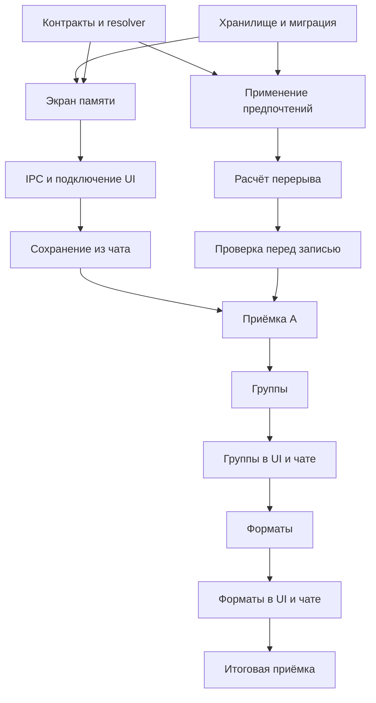

# План: память ассистента

Дата: 30 октября 2026 года. Статус: **реализовано, подготовлено к ревью**.
Основание: [требования](../../docs/proposals/assistant-memory.md).
Задачи и проверки: [todo.md](todo.md).

Активные этапы A–C выполнены и связаны с основным [реестром](../todo.md).
Сохранение чатов остаётся в [бэклоге](backlog.md). Принятые технические решения,
отличия от первоначальной декомпозиции и результаты проверок записаны в
[документации реализации](../../docs/implementation/assistant-memory.md).

## Технический подход

1. Общий слой memory-store в main: типизированные записи, происхождение и revision,
   произвольный текст сохранённого контекста отдельно от предпочтений встреч,
   аккаунт из сессии, атомарное локальное хранение. Категории хранятся в одном зашифрованном конверте аккаунта.
2. Переиспользовать локальный шифр после проверки его актуального состояния.
   Память использует защищённый namespace LocalSecrets, поэтому существующее
   обнаружение зависимых шифротекстов включает её без отдельного реестра файлов.
3. Предпочтения применять общим resolver в main. Сохранённое значение, явное
   переопределение и стандартное значение имеют различимое происхождение.
   Модель не определяет окончательные правила проверки занятости.
4. Сохранение из чата: модель готовит предложение, main создаёт короткоживущее
   подтверждение с account ID, message ID, изменением и ожидаемой revision.
   Renderer показывает точные значения; нажатие фиксирует их через узкий IPC.
   Подмена данных карточки, повтор запроса и смена аккаунта проверяются в main.
5. Группы и форматы используют тот же store и UI. Каталог и календарь остаются
   источниками актуальных участников, прав и занятости.

Локальный JSON выбран как предлагаемый старт ради малого объёма и существующего
паттерна. Архив, индексы и восстановление чатов в текущем объёме не проектируются;
идея остаётся в [бэклоге](backlog.md). Контекст диалога остаётся в RAM.

## Последовательность поставки

| Этап                         | Задачи  | Демонстрируемый результат                                          | Условие завершения                        |
| ---------------------------- | ------- | ------------------------------------------------------------------ | ----------------------------------------- |
| A: предпочтения и управление | M01–M09 | Сохранить 30 минут, применить после перезапуска, исправить/удалить | P01–P06, K01–K03, U01–U03 и общие M01–M06 |
| B: группы                    | M14–M15 | Вызвать именованный состав, исправить его в памяти                 | G01–G03                                   |
| C: форматы                   | M16–M17 | Подготовить привычную встречу с разовым исключением                | F01–F03, общий порядок приоритетов        |
| Завершение                   | M18     | Документация и регрессии всех этапов                               | Матрица приёмки и Definition of Done      |

M01–M02 — ограниченная подготовка общего основания, далее каждый срез подключает
конкретный пользовательский сценарий. Не строить универсальную платформу памяти
до первого работающего предпочтения. Задачи с общей точкой изменения выполнять
последовательно. Тесты/макеты независимого компонента можно готовить отдельно
после фиксации контракта; план не запускает дополнительных агентов.

## Миграция и восстановление

- До замены старого ParticipantMemory прочитать и проверить все поля; сохранить
  IDs, прозвища, uses и updatedAt во внутренних метаданных. Прозвища представить
  текстовыми записями контекста, источник отметить как legacy-import. Изменение
  смысла текста требует инвалидировать прежнюю привязку к человеку.
- Новый формат записать и перечитать, затем атомарно опубликовать маркер завершения.
  Старый файл удалить только после успешного переключения. Промежуточное состояние
  после сбоя должно быть однозначно восстановимо, без двойного импорта.
- Пока переключение не завершено, единственный writer остаётся старым; после
  завершения все операции идут через новый store. Не поддерживать два writer.
- Повреждённый файл не импортировать частично и не удалять автоматически.
  Явная очистка повреждённой категории должна оставаться доступной.
- Новую неизвестную версию не перезаписывать старой сборкой. Безопасный откат —
  отключение новой функции с сохранением файлов, не обратная миграция наугад.

## Риски и проверки

| Риск                                      | Мера                                                 | Контроль                                                    |
| ----------------------------------------- | ---------------------------------------------------- | ----------------------------------------------------------- |
| Изменяется local-secrets в другой работе  | Пересверить интерфейс и владельцев ключа перед M02   | Потеря ключа при наличии только памяти                      |
| Модель сохраняет случайную фразу          | Явная просьба и пользовательское подтверждение       | Обычная просьба и инструкция из события ничего не сохраняют |
| Удалённая память возвращается из истории  | Актуальный снимок и исключение старых memory-results | Продолжение того же чата после удаления                     |
| Перерыв проверяется только в prompt       | Общая проверка main и занятость соседних дат         | Границы 14/15 минут и полночь                               |
| Изменение памяти между подбором и записью | Revision зависимостей черновика                      | Повторное подтверждение после изменения                     |
| Файл повреждён / диск заполнен            | Атомарная запись и явная ошибка                      | Fault injection, прежние данные целы                        |

## Проверка и ревью

Каждая задача получает unit-проверку поведения, интеграционная граница —
Electron E2E. После каждых двух-трёх задач контрольная точка из todo.md.
Полные команды сверены с текущим package.json; они перечислены в требованиях.
Имена новых test-файлов в задачах — предлагаемые, их сейчас ещё нет.

Перед этапом A согласовать правила из раздела «Решения для ревью» требований.
Перед B/C уточнить сценарии именования
на реальном интерфейсе без приглашений сотрудникам. Завершённый этап показать
в Electron; зелёные unit-тесты не заменяют runtime-проверку.

Сроки в календарных днях не назначены: основная неопределённость — интеграция
перерыва с повторной проверкой записи. Начальная оценка после M01–M03.
M10–M13 исключены из текущего плана, остальные ID задач сохранены.
Сохранение чатов не блокирует ни один текущий этап.
